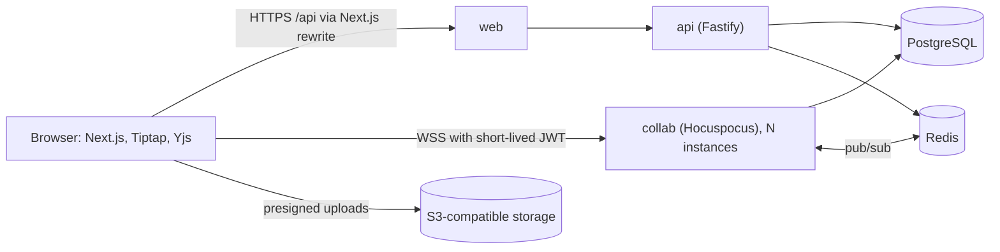

# CoNote – Real-Time Collaborative Workspace

> **Project status: Phases 1–3 are implemented and owner-verified locally; Phase 4 (single-user rich-text editor) is implemented and awaiting owner verification.** You can register, manage workspaces, members, invitations and nested pages with permissions, and edit a page's content in a rich-text editor (headings, formatting, lists, checklists, links, tables, images, alignment, slash commands) with autosave. **Real-time collaboration, presence, comments and version history are not implemented**; everything under "Planned features" is the *plan*. Phase 4 saves content with an interim mechanism that Phase 6 replaces (`docs/DECISIONS.md` D54). Current status: `docs/HANDOVER.md`.

CoNote is a collaborative workspace inspired by Notion and Figma. Multiple people will be able to edit the same rich-text page at the same time, see each other's cursors and presence, discuss content in comment threads, and browse or restore earlier versions, without losing concurrent changes.

## Planned features

| Area | Planned capabilities |
|---|---|
| Authentication | Registration and login, secure server-side sessions, user profiles, protected routes |
| Workspaces | Create and manage workspaces, invite members by link, roles (Owner, Admin, Editor, Commenter, Viewer) |
| Pages | Nested pages, soft delete and restore, per-page permission overrides, autosave |
| Rich-text editor | Headings, paragraphs, bold/italic/underline, lists, checklists, links, images, tables, slash commands, extensible architecture |
| Real-time collaboration | Yjs CRDT, simultaneous editing, reconnection and recovery, multiple sessions |
| Presence | Avatars, colored cursors with names, selection highlighting, online list, join/leave notifications |
| Comments | Anchored comment threads, replies, resolve/reopen |
| Version history | Snapshots, view previous versions, restore as a new change |
| Scalability | Multiple collaboration-server instances using Redis; persistent Yjs storage in PostgreSQL; recovery after restarts |

Not planned for the first version: offline-first editing, external guest access, public page sharing, email verification/password reset. See `docs/PROJECT_MASTER.md` for the full scope.

## Technology stack (planned)

| Layer | Technology |
|---|---|
| Frontend | Next.js (App Router), React, TypeScript, Tailwind CSS |
| Editor | Tiptap / ProseMirror |
| Collaboration | Yjs (CRDT), Hocuspocus WebSocket server, Redis |
| API | Node.js, Fastify, Zod |
| Data | PostgreSQL, Prisma ORM |
| Object storage | Planned S3-compatible storage (MinIO/local option to be verified in Phase 4; not present in Phase 1 Compose) |
| Tooling | pnpm workspaces, Docker, Vitest, Playwright |

Exact pinned versions are listed in `docs/PROJECT_MASTER.md` §6. Phase 1a pins were installed and exercised by the reported checks and CI; future-phase dependencies are reverified when introduced.

## Planned architecture



- **PostgreSQL is the durable source of truth**, including collaborative document recovery. **Redis is coordination only** and never permanent storage.
- Documents are persisted as incremental Yjs updates, compacted periodically, with immutable snapshots for version history.
- The project does not claim zero data loss or automatic reconvergence after Redis outages: persistence and recovery guarantees are explicitly defined and will be stated as verified only when their tests pass (`docs/ARCHITECTURE.md` §8).

## Repository layout

```text
conote/
├── apps/
│   ├── web/        # Next.js frontend
│   ├── api/        # REST API and application services
│   └── collab/     # Hocuspocus collaboration server
├── packages/
│   ├── db/         # Prisma schema, migrations, document store
│   ├── shared/     # Zod schemas, types, permission logic
│   └── editor/     # Tiptap extensions and Yjs binding
├── docs/           # Architecture and planning documents
├── infra/          # Docker Compose and Dockerfiles
├── scripts/        # Setup scripts
├── tests/          # Cross-cutting tests (module boundaries, process startup)
├── .github/        # CI workflow
└── CLAUDE.md       # Permanent instructions for AI-assisted development
```

`shared` holds env validation, error codes, the response envelope, health types and the authentication schemas; `db` holds the Prisma setup with the `User` and `Session` models; `editor` is an empty entry point; `api` serves the authentication and profile endpoints (`/api/v1/auth/*`, `/api/v1/users/me`); `web` has the sign-in, registration and profile pages and proxies `/api/*` to the API; `collab` is still a shell with health endpoints.

## Prerequisites and setup

Prerequisites: Node.js 24 (`.nvmrc`), pnpm 12.18.0 (`corepack enable`), Docker with Compose v2.

```bash
pnpm bootstrap        # creates .env, installs, starts PostgreSQL + Redis, builds packages, runs migrations
pnpm dev:api          # http://localhost:4000   (/health, /ready)
pnpm dev:collab       # http://localhost:4100   (/health, /ready)
pnpm dev:web          # http://localhost:3000   (/health)
```

Manual equivalent: `cp .env.example .env`, `pnpm install`, `pnpm infra:up`, `pnpm build:packages`, `pnpm db:migrate:deploy` (the db scripts read the repository-root `.env` automatically).

Quality checks: `pnpm lint`, `pnpm format:check`, `pnpm typecheck`, `pnpm test:unit`, `pnpm test:integration` (needs `pnpm infra:up` + migrations), `pnpm build`. Run everything with `pnpm check`. See `docs/TESTING.md` §12.

Optionally run the three apps in containers too: `docker compose -f infra/docker-compose.yml --profile apps up --build` (the app images are provided but have not been built in CI yet).

Credentials in `.env.example` are local development defaults only. Never commit `.env`.

## Roadmap

| Phase | Name | Status |
|---|---|---|
| 0 | Documentation and Architecture | Documentation written |
| 1 | Project Setup and Infrastructure (including a disposable collaboration spike) | Infrastructure done; collaboration spike not done (D33) |
| 2 | Authentication and User Management | Implemented, owner-verified locally |
| 3 | Workspaces, Pages and Permissions | Implemented, owner-verified locally; final acceptance pending |
| 4 | Rich-Text Editor | Implemented (interim persistence; local-disk image storage); awaiting owner verification |
| 5 | Yjs CRDT Integration | Not started |
| 6 | WebSocket Server and Real-Time Collaboration | Not started |
| 7 | Presence and Collaborative UI | Not started |
| 8 | Comments and Version History | Not started |
| 9 | Redis Scaling and Performance | Not started |
| 10 | Testing, Security and Optimization | Not started |
| 11 | Deployment and Final Documentation | Not started |

Details and acceptance criteria: `docs/IMPLEMENTATION_PLAN.md`.

## Documentation

| Document | Contents |
|---|---|
| [`docs/PROJECT_MASTER.md`](docs/PROJECT_MASTER.md) | Overview, requirements, permissions, technology stack |
| [`docs/ARCHITECTURE.md`](docs/ARCHITECTURE.md) | Components, flows, persistence guarantees, diagrams |
| [`docs/DATABASE_SCHEMA.md`](docs/DATABASE_SCHEMA.md) | Prisma/PostgreSQL design |
| [`docs/API_CONTRACTS.md`](docs/API_CONTRACTS.md) | REST API contracts |
| [`docs/WEBSOCKET_PROTOCOL.md`](docs/WEBSOCKET_PROTOCOL.md) | Collaboration protocol and application messages |
| [`docs/DECISIONS.md`](docs/DECISIONS.md) | Numbered decisions and unresolved questions |
| [`docs/IMPLEMENTATION_PLAN.md`](docs/IMPLEMENTATION_PLAN.md) | Phase-by-phase roadmap |
| [`docs/TESTING.md`](docs/TESTING.md) | Test strategy and measurable metrics |
| [`docs/DEPLOYMENT.md`](docs/DEPLOYMENT.md) | Production infrastructure and operations |
| [`docs/HANDOVER.md`](docs/HANDOVER.md) | Current status and next steps |

## Working method

Development proceeds one phase at a time with owner approval between phases. Architectural decisions are recorded with permanent IDs in `docs/DECISIONS.md`, and unresolved questions are listed rather than assumed. See `CLAUDE.md` for the rules that govern AI-assisted work on this repository.

## License

Not yet chosen (see `docs/DECISIONS.md` U12).