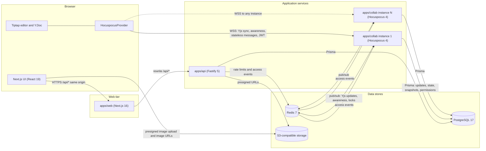
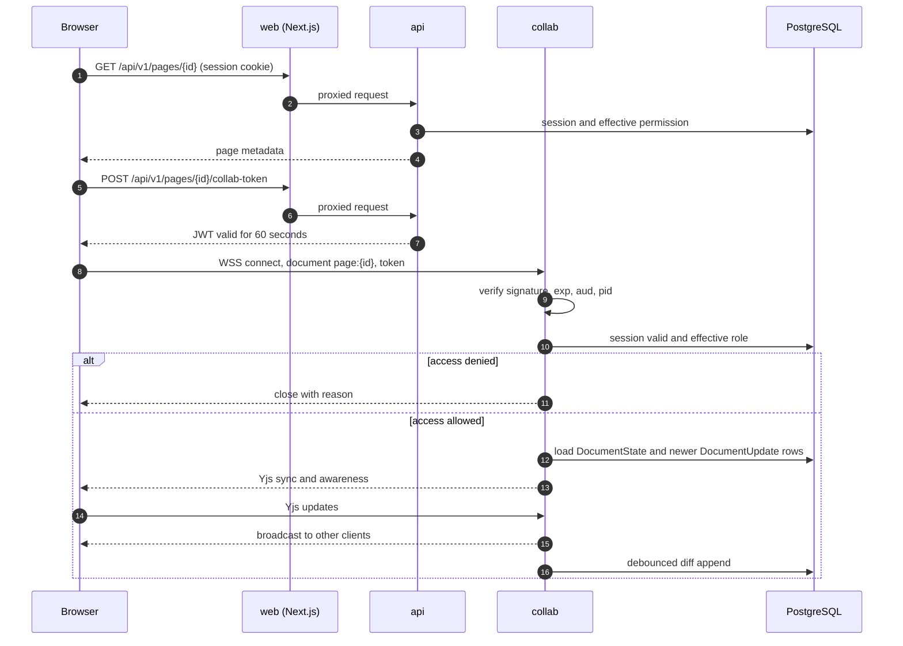
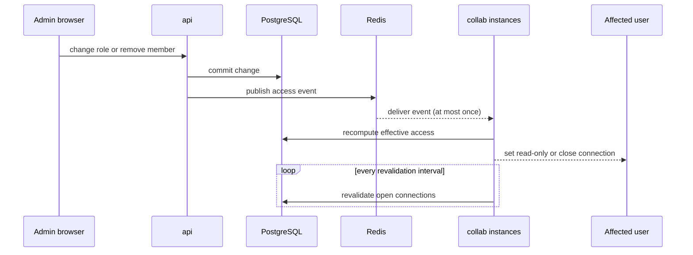

# CoNote – Architecture

**Status:** Phase 1 infrastructure and **Phase 2 authentication (§10)** are implemented and locally verified by the owner. Decisions D41–D47 were accepted by the owner on 2026-11-13. The collaboration architecture, persistence model and the remaining product features remain design-only.
**Last updated:** 2026-11-19 (Phase 6 added, §23; Phase 6 verified locally and D58–D60 accepted; Phase 7 presence, awareness §6/§18 of WEBSOCKET_PROTOCOL, verified locally by the owner on 2026-11-19 and D61 accepted)

Decision IDs (`D#`) and unresolved IDs (`U#`) are defined in [DECISIONS.md](DECISIONS.md). Requirement IDs (`FR-*`, `NFR-*`, `PERF-*`) are in [PROJECT_MASTER.md](PROJECT_MASTER.md). Statements marked **(to verify)** are assumptions that the Phase 1 spike or a named phase must confirm before they are relied on (collected in §18).

## 1. Purpose and scope

This document describes how CoNote's parts fit together: components, data ownership, the collaboration and persistence design, security architecture, failure behaviour and known limits. Table definitions are in DATABASE_SCHEMA.md, REST contracts in API_CONTRACTS.md and the collaboration wire protocol in WEBSOCKET_PROTOCOL.md.

## 2. Architectural principles

1. **Separation of concerns.** UI (`web`), application services (`api`), real-time collaboration (`collab`) and data stores are separate (D3, D11).
2. **PostgreSQL is the source of truth.** Redis is coordination only and is never required for correctness of stored data (D14).
3. **Authorize on the server, everywhere.** REST and WebSocket both enforce permissions; the UI only reflects them (D22, D23).
4. **Yjs sync is distinct from application events.** Yjs updates and awareness are never mixed with application messages (D32).
5. **No hidden guarantees.** Persistence and recovery claims are limited to G1–G7 (§8) and are claimed only after tests pass (D14).
6. **Shared logic lives in packages.** Permission resolution and schemas are shared pure code (`packages/shared`).
7. **Keep it simple.** No component is added without a stated need (e.g. no Turborepo, no workspace-level realtime channel in the MVP).

## 3. System context



Notes:

- The API is **not exposed publicly**; browsers reach it only through the Next.js rewrite (D6). Server-side rendering code calls it directly on the internal network.
- WebSocket connections go **directly** from the browser to the collab tier (not through Next.js rewrites), authenticated by a collaboration JWT (D6, D7, D22).

## 4. Components

| Component | Location | Responsibility | Does **not** do |
|---|---|---|---|
| Web | `apps/web` | Next.js UI, routing, route protection, editor host, `/api` rewrites, calls the API during SSR | Business logic, database access, Yjs persistence |
| API | `apps/api` | REST endpoints, authentication and sessions, workspaces, invitations, pages (metadata), permissions, comments, version history reads, activity logs, collaboration-token issuing, image upload authorization, access-event publishing | Serve Yjs sync; write collaborative document content |
| Collab | `apps/collab` | Hocuspocus server: WebSocket authentication and authorization, Yjs sync and awareness, document load/store, snapshots creation and restore, document-scoped stateless messages, revalidation and revocation handling | REST endpoints; password/session management |
| DB package | `packages/db` | Prisma schema, migrations, generated client, document store module (load/append/compact), query helpers | HTTP, business rules beyond data access |
| Shared package | `packages/shared` | Zod schemas, TypeScript types, error codes, **pure** permission-resolution logic, constants (document name format, event names) | I/O of any kind |
| Editor package | `packages/editor` | Tiptap extension registry, slash-command definitions, Yjs binding configuration, comment-anchor helpers | Network calls, persistence |
| PostgreSQL | infra | Durable data (application data, Yjs updates, state, snapshots) | — |
| Redis | infra | Hocuspocus fan-out, locks, rate-limit counters, access-event pub/sub | Permanent storage |
| Object storage | infra | Image binaries (D10) | Document content |

## 5. Monorepo and module boundaries

```text
conote/
├── apps/
│   ├── web/        # Next.js
│   ├── api/        # Fastify REST
│   └── collab/     # Hocuspocus
├── packages/
│   ├── db/         # Prisma + document store
│   ├── shared/     # schemas, types, permission logic (pure)
│   └── editor/     # Tiptap extensions + Yjs binding
├── docs/
├── infra/          # Docker/Compose files
├── pnpm-workspace.yaml
├── package.json
├── tsconfig.base.json
└── .nvmrc
```

**Dependency rules** (enforced by lint rules such as `no-restricted-imports`, added in Phase 1):

| Package | May depend on |
|---|---|
| `shared` | nothing in the repo |
| `db` | `shared` |
| `editor` | `shared` |
| `api` | `shared`, `db` |
| `collab` | `shared`, `db`, `editor` (D58, accepted 2026-11-18; entry point `@conote/editor/collaboration` only) |
| `web` | `shared`, `editor` |

Forbidden: apps importing from other apps; `web` importing `db`; `shared` importing anything with I/O. No circular dependencies.

Tooling: pnpm workspaces only; no Turborepo initially (D11). `tsconfig.base.json` sets `strict` and `noUncheckedIndexedAccess` (D12). Versions are exact pins (D13).

## 6. Data ownership

| Data | Owner (writes) | Stored in |
|---|---|---|
| Users, sessions, profiles | `api` | PostgreSQL |
| Workspaces, members, invitations | `api` | PostgreSQL |
| Page metadata (title, icon, parent, position, soft-delete flag), page permissions | `api` | PostgreSQL |
| **Page body** (rich text) | `collab` (via Yjs) | PostgreSQL: `DocumentState`, `DocumentUpdate` |
| Version snapshots | `collab` (create, restore); `api` (read, list) | PostgreSQL: `DocumentSnapshot` |
| Comment threads, replies, anchors | `api` | PostgreSQL |
| Activity logs | `api` (most events), `collab` (edit activity) | PostgreSQL |
| Image binaries | `api` authorizes; client uploads | Object storage |
| Presence (awareness) | clients (ephemeral) | Memory and Redis transit only; never persisted |
| Rate-limit counters, access events | `api` | Redis (transient) |

**Page title and tree are not part of the Yjs document**; they are plain REST resources (FR-PG-02). This keeps the page tree queryable and permission-checked in SQL.

## 7. Yjs fundamentals used

(Reference: Yjs documentation. API names are those documented by Yjs; exact usage is confirmed in Phases 1, 5 and 6.)

### 7.1 Document lifecycle

1. A page has exactly one collaborative document, named **`page:<pageId>`** (the page UUID).
2. A `Y.Doc` is created in memory on a collab instance when the first authorized client connects, hydrated from PostgreSQL (§8), and kept while connections exist.
3. Clients each hold a local `Y.Doc` bound to the Tiptap editor through the Collaboration extension (rich text is stored in a `Y.XmlFragment`).
4. When the last client disconnects, Hocuspocus unloads the document after storing it **(to verify: store-on-unload)**.

### 7.2 Updates and state vectors

- A **state vector** summarizes which operations a replica has. `Y.encodeStateVector(doc)` produces it.
- An **update** is a binary-encoded set of operations. `Y.encodeStateAsUpdate(doc, targetStateVector)` produces only what a replica with that state vector is missing; without a vector it produces the full state.
- `Y.applyUpdate(doc, update)` is idempotent and commutative, so duplicate or reordered updates are safe. Updates can be combined with `Y.mergeUpdates`.
- The sync handshake exchanges state vectors (step 1) and missing updates (step 2) in both directions, then streams incremental updates. A reconnecting client therefore re-sends edits the server has not seen.

CoNote uses diffs against a persisted state vector (§8) and full-state encodings for snapshots. It does **not** use Yjs's snapshot-diff feature (which requires disabling garbage collection); GC stays at its default.

### 7.3 Awareness

Awareness (cursor, selection, user name and color) is ephemeral per-client state exchanged through the Yjs awareness protocol. It is never written to PostgreSQL. An unrefreshed client state expires after 30 s (a constant of y-protocols 1.0.7, checked every 3 s; clients renew every 15 s), which also cleans up after crashed clients. The server rebuilds every relayed state from the verified identity and a validated cursor (Phase 7, D61, WEBSOCKET_PROTOCOL §18); presence UI is derived from awareness, and join/leave notices from awareness changes.

### 7.4 Tiptap integration

- Tiptap 3 Collaboration extension binds the editor to a `Y.Doc` (D20); CollaborationCaret renders remote carets and selections.
- StarterKit's built-in undo/redo is disabled because the Collaboration extension provides collaborative history (users undo only their own changes).
- `HocuspocusProvider` connects the `Y.Doc` to the collab server.

### 7.5 Concurrent editing and conflict resolution

Concurrent edits are merged by the Yjs CRDT: replicas that have applied the same updates converge (G1). There is no server-side conflict resolution code and no last-write-wins for document content. Semantic conflicts (two users changing the same word) resolve per Yjs's deterministic ordering, which can interleave text; this is inherent in the CRDT and not a data-loss condition.

## 8. Persistence, recovery and guarantees

### 8.1 Storage model (D15)

| Table | Content | Notes |
|---|---|---|
| `DocumentUpdate` | Append-only **incremental** Yjs updates (diffs), ordered by `seq` (BigInt) | Never the whole document per edit |
| `DocumentState` | One row per page: `foldedState` (compacted full state), `persistedStateVector` (coverage of `foldedState` plus all stored updates), `foldedSeq` (highest update `seq` merged in) | Updated by compaction and by every store transaction; also the per-page lock row |
| `DocumentSnapshot` | Immutable full state for version history | Created by auto rule, manual action or before restore |

### 8.2 Write path (baseline, to verify in the spike – U3)

On Hocuspocus's debounced store hook for a document:

1. Begin a PostgreSQL transaction and **lock the document's `DocumentState` row**, serializing concurrent stores from different instances.
2. Read the **persisted state vector**.
3. Compute `diff = Y.encodeStateAsUpdate(liveDoc, persistedStateVector)`. If it is empty, stop.
4. Insert one `DocumentUpdate` row containing `diff`.
5. Set the persisted state vector to the **per-client maximum** of the previous persisted vector and the live document's vector (not simply the live vector: another instance may have persisted content this instance has not yet received).
6. Commit.

Initial tunables (D15; adjusted with measurements, not performance claims): store debounce 2000 ms, max debounce 10000 ms, compaction after 200 update rows or on document unload.

### 8.3 Compaction

In a single transaction: lock `DocumentState`, merge the state with all `DocumentUpdate` rows (`Y.mergeUpdates`), write the new state, vector and `foldedSeq`, and delete the folded rows. If the transaction fails, the previous state and rows are unchanged.

### 8.4 Recovery (load path)

On document load: read `DocumentState` (if any), apply all `DocumentUpdate` rows with `seq > foldedSeq` in order, and hydrate the `Y.Doc`. Recovery time depends on state size and pending update count (PERF-06) and is measured, not assumed.

### 8.5 Guarantees

These are the only persistence and recovery guarantees the project will claim. Each is **claimed only after its tests pass** (TESTING.md "Guarantee verification"). The project does **not** claim zero data loss (D14).

| ID | Guarantee | Basis | Verified by |
|---|---|---|---|
| **G1** | **Convergence.** All replicas (clients and collab instances) that have applied the same set of Yjs updates hold the same document state. | Yjs CRDT property | Randomized concurrent-editing tests across clients and instances |
| **G2** | **Durability point.** An update is durable if and only if the PostgreSQL transaction that stores it has committed. Updates only in memory, in Redis, or in a client are not durable. | D14, §8.2 | Persistence integration tests; kill-before/after-commit tests |
| **G3** | **Bounded at-risk window.** Not-yet-committed updates exist only in collab instance memory, Redis transit and client memory. They can be lost only if every holder fails or disconnects permanently before commit. A client that stays open re-sends updates the server lacks after reconnecting (sync handshake). The window's size is bounded by the store debounce settings and is measured (PERF-05). | Yjs sync protocol, §8.2 | Crash-during-window tests with and without a surviving client |
| **G4** | **Recovery.** After a collab restart or instance loss, a document is rebuilt from `DocumentState` plus later `DocumentUpdate` rows and includes every committed update. Compaction is atomic, so it never loses committed data. | §8.3, §8.4 | Recovery tests; compaction fault-injection tests |
| **G5** | **Redis independence.** Redis loss, restart or flush never corrupts or resurrects committed PostgreSQL data. During a Redis outage, cross-instance live propagation is unavailable. Redis Pub/Sub does not replay messages missed while disconnected; reconnecting Redis alone does **not** guarantee that already-open in-memory documents reconverge. Recovery requires an explicit resynchronization path (for example, force affected clients to reconnect to a freshly hydrated document, or use a separately verified server-to-server reconciliation protocol). Until that path is implemented and tested, G5 guarantees durable-data independence only; live reconvergence is not guaranteed. | D14, D2 | Redis failure/recovery tests with two instances, missed-message detection and explicit resync tests |
| **G6** | **Authorization.** A connection never receives or applies updates for a page the user is not authorized for at connect time. After an access change, open connections are downgraded or closed within a bounded interval (event delivery, or at most the revalidation interval). | D22, D23 | Permission and revocation tests |
| **G7** | **Snapshot integrity.** Snapshots are immutable; restore never deletes snapshots and always creates a pre-restore snapshot first. | D9 | Version-history tests |

Known limits, stated plainly: edits applied on the server but not yet committed are lost if the instance dies **and** no client that has them remains; edits made in a browser tab that is closed during that window are not recoverable; there is no offline persistence in the MVP.

## 9. Multi-instance synchronization (D2)

```text
Client A ── WSS ── Collab 1 ──┐                 ┌── Collab 2 ── WSS ── Client B
                              ├── Redis pub/sub ┤
                              └── (updates, awareness, locks)
                  Collab 1, Collab 2 ──► PostgreSQL (durable)
```

Behaviour per the official Redis extension documentation:

- Every update and awareness change received by one instance is published through Redis and applied on all other instances, which forward it to their clients.
- **All messages are handled on all instances.** More instances increase connection capacity and availability, not per-document CPU capacity.
- A document loading on instance 2 while open on instance 1 waits for instance 1's current state, up to `awaitInitialSyncTimeout` (default 1000 ms), so a new client sees unpersisted collaborative state rather than only what storage holds.

**Failure and recovery semantics (normative):**

- Redis Pub/Sub is at-most-once delivery. Messages published while an instance is disconnected are not replayed automatically.
- An instance that remains connected to Redis while another instance is disconnected may continue to hold a divergent in-memory document. Redis reconnection by itself is not a reconciliation protocol.
- PostgreSQL remains authoritative for committed updates. Uncommitted updates held only by a failed instance may be lost within the G3 at-risk window.
- Phase 9 must implement and test an explicit recovery procedure. The conservative baseline is to mark the affected instance/document generation as requiring resync, stop serving stale state, flush what can be committed, then force clients to reconnect to a document hydrated from PostgreSQL. A surviving client may contribute newer uncommitted Yjs updates during its normal handshake. A server-to-server reconciliation design is acceptable only if independently tested.
- Until this procedure passes the two-instance outage tests, do not claim that live instances automatically reconverge after Redis returns. Keep the document unavailable or force reconnect rather than silently serving known-stale state.
 If the timeout elapses, the instance proceeds with the stored state and later syncs through Yjs.
- Stores are mutually exclusive across instances in the extension; CoNote additionally serializes stores with a database row lock (§8.2) so correctness does not rely on Redis locking.
- Redis does not persist anything (D14).

Behaviour that must be verified in the spike (U3, U4): whether updates arriving from Redis trigger the store hook on every instance (duplicate rows, harmless but wasteful), debounce option names, awareness propagation across instances and from read-only connections, and reconvergence after a Redis outage.

**Future optimization (not in MVP):** sticky routing of a document to one instance (e.g. consistent hashing on document name at the load balancer) to avoid redundant processing; recorded as a possible later decision.

Application events for access changes use a separate Redis pub/sub channel (§11), not the Hocuspocus extension's channels.

## 10. Authentication, sessions, cookies and REST security

### 10.1 Authentication (D5)

- Registration and login with email and password; Argon2id hashing (`argon2` 0.45.2). **Phase 2 parameters: m = 19456 KiB, t = 2, p = 1 (the OWASP baseline, unchanged from the initial value).** Measured in the preparation sandbox (1 vCPU Intel Xeon @ 2.10 GHz, Node 24.18.0, 30 runs): hash median 26.0 ms, p95 28.6 ms; verify median 26.0 ms, p95 28.5 ms; 8 concurrent hashes took 260 ms in total. This is a small shared machine, **not** production hardware: re-measure on the deployment target and raise the cost if verification is under roughly 100 ms there (no change was made because no target hardware or latency budget has been defined).
- Login creates a **session**: 32 random bytes, base64url-encoded, sent to the browser in a cookie. PostgreSQL stores only the **SHA-256 hash** plus user id, created/last-seen/expiry timestamps, user agent and IP.
- Lifetimes: `SESSION_IDLE_TTL_DAYS` (default 7, allowed 1–365) and `SESSION_ABSOLUTE_TTL_DAYS` (default 30, allowed 1–365). Idle expiry slides; absolute expiry does not. Logout, password change and "revoke session" invalidate sessions. The cookie name is derived from `NODE_ENV`, not configured independently.
- Login failures are rate-limited and use uniform error messages to avoid account enumeration.
- **Phase 2 implementation:** passwords are 12–128 characters, stored exactly as typed (no trimming) and never logged or returned; an unknown email performs a dummy Argon2id verification so both failure paths cost about the same. The API's `User` resource is built by explicit field mapping and the response schema strips unknown keys, so a password hash cannot leave through the API. A new session token is issued on every login. Passwords are not checked against breached-password lists and there is no email verification or password reset yet (not in the Phase 2 scope).

### 10.2 Session cookie

| Attribute | Value |
|---|---|
| Name | `__Host-conote_session` in production; `conote_session` in local HTTP development (`__Host-` requires `Secure`) |
| `HttpOnly` | yes |
| `Secure` | yes in production |
| `SameSite` | `Lax` |
| `Path` | `/` |
| `Domain` | **not set** (host-only cookie on the web origin) |
| `Max-Age` | configured absolute lifetime (`SESSION_ABSOLUTE_TTL_DAYS`, default 30 days); the server also enforces sliding idle expiry (`SESSION_IDLE_TTL_DAYS`, default 7 days) |

The cookie name is fixed by environment: `__Host-conote_session` when `NODE_ENV=production`, otherwise `conote_session` (D42). `SESSION_COOKIE_NAME` is not an implemented configuration variable. Both TTL variables accept integer day values from 1 through 365.

### 10.3 Same-origin proxy (D6)

Implemented in `apps/web/next.config.ts`:

```ts
async rewrites() {
  return [{ source: '/api/:path*', destination: `${apiInternalUrl}/api/:path*` }];
}
```

Next.js resolves rewrites **when the app is built**, so `API_INTERNAL_URL` must be present at `next build` time (`infra/Dockerfile.web` takes it as a build argument), not only at runtime.

Rules:

1. The browser only calls `/api/...` on the web origin; the API's `Set-Cookie` passes back through the rewrite, so the cookie belongs to the web origin.
2. `TRUST_PROXY` is a comma-separated list of trusted IP addresses, CIDR ranges or the keywords `loopback`, `linklocal`, `uniquelocal`; an empty value trusts no proxy. Fastify derives the client IP by walking the forwarded chain from the right to the first untrusted address, and ignores forwarded headers from an untrusted immediate peer. A boolean or hop count is not accepted (D43). **V7 – measured in Phase 2 (Next.js 16.4.6, dev server and `next start` production build, against an echo server standing in for the API):** the rewrite forwards the request method, path, body, `Origin`, `Cookie` and `Content-Type` unchanged, passes response status and `Set-Cookie` back unchanged, and sets `Host` to the API host and `X-Forwarded-Host` to the web host. **It does not set `X-Forwarded-For` or `X-Forwarded-Proto`, and a client-supplied `X-Forwarded-For` is forwarded unmodified.** Therefore production must put a reverse proxy in front of the web app that sets/overwrites `X-Forwarded-For`; the web app must not be reachable except through that proxy; and the API's `TRUST_PROXY` must list the web tier's address(es), not blindly trust a hop count or all forwarded headers. Without this topology, IP limits either see a shared web-server address (if nothing is trusted) or can be spoofed (if untrusted client-supplied values are trusted). Per-account login and per-user password-change limits are unaffected. Server components forward the incoming `X-Forwarded-For` on their direct API calls for the same reason.
3. Server components and route handlers that need API data call `API_INTERNAL_URL` directly and forward the session cookie explicitly.
4. The API is on a private network and not reachable from the internet.
5. WebSockets do **not** use this proxy.

### 10.4 REST request security (D25)

- **CSRF:** `SameSite=Lax` plus, for `POST/PUT/PATCH/DELETE`: required `Content-Type: application/json` and a validated `Origin` header against an allow-list. *Implemented (Phase 2).* A request without an `Origin` header is rejected: browsers always send one on these methods, so non-browser clients must set it.
- **Request pipeline (D44):** Origin/Content-Type checks and rate limiting run in `onRequest`; the body is parsed; authentication runs in `preValidation`; schema validation and then the route handler follow. This deliberately makes an unauthenticated request receive `401` before a schema validation error (`400`). The 64 KiB body limit and rate limiter bound unauthenticated work; malformed JSON is rejected during body parsing.
- **CORS:** explicit origin allow-list (defence in depth, since the API is not called cross-origin). *Implemented* (`@fastify/cors` 11.4.1, credentials allowed only for listed origins).
- **Headers:** `@fastify/helmet` 13.2.0 defaults. *Implemented.* `Cache-Control: no-store` on every `/api/*` response. The web app's own response headers (CSP etc.) are not configured yet (Phase 10).
- **Rate limiting (D45):** `@fastify/rate-limit` 11.2.2 is backed by Redis. Per-IP limits use the plugin per route (`global: false`); account-scoped login-per-email and password-change-per-user limits use `createRateLimit` with a non-IP key and the same Redis store. Implemented Phase 2 limits and untuned initial values are in API_CONTRACTS §3.1. All attempts count, including successful logins. This means someone who knows an email address can block password login for that account for up to the 15-minute window. **Fail closed:** when Redis is unreachable every rate-limited endpoint returns `503`; there is no per-process fallback. Because the general authenticated-request limit is also rate-limited, authenticated requests are blocked during a Redis outage.
- **Validation:** Zod schemas at every endpoint; unknown fields rejected; request bodies limited to 64 KiB (`413`).
- **Authorization:** every endpoint resolves the actor and calls the shared permission function (D23) before acting; failures return the standard error envelope (D31).

### 10.5 Web authentication flow (D46)

- Protected pages call `requireUser()` in a server component, forwarding the incoming session cookie to the API. The `(app)` layout also checks the user, but layouts are not re-run on client-side navigation, so each protected page repeats the check.
- If the API returns `401 UNAUTHENTICATED`, the page/action redirects or signs the UI out to `/login`. Other lookup failures (for example, API unavailable) are errors and must not be misrepresented as an expired session.
- The root layout seeds the client `AuthProvider` with the public user profile. Browser actions use same-origin `/api/v1/*` requests. The session token remains in the HttpOnly cookie and is never readable by client-side scripts.
- There is no `next`/return-URL parameter and no Next.js middleware/proxy file. Frontend coverage uses jsdom component tests plus an HTTP-level test against the real Next.js server; Playwright browser E2E is not yet implemented (D26, D46).

## 11. WebSocket authentication and authorization (D7, D22)

Summary; the full protocol is in WEBSOCKET_PROTOCOL.md.

1. The client asks the API for a collaboration token for a page: `POST /api/v1/pages/:pageId/collab-token` (requires a valid session and read access). The API returns an **EdDSA-signed JWT**, TTL 60 s, bound to the user, session and page.
2. The client connects to `wss://<collab-origin>` with document name `page:<pageId>` and supplies the token through the provider's authentication step (the token is not placed in the URL **(to verify)**). The `Origin` header must be on the allow-list.
3. In the authentication hook the collab server verifies signature, `exp`, `aud`, `iss`, and that `pid` matches the requested document; then loads from PostgreSQL the **current** session validity and **effective page role** (D23). No access → the connection is rejected. Viewer and Commenter → connection marked read-only; Editor and above → read-write.
4. The role in the token is not trusted. Token expiry does not end an established connection; every reconnection fetches a new token.
5. **Revocation:** the API publishes an access event on Redis (session revoked, member removed or role changed, page permission changed). Collab instances recompute access for affected connections and downgrade or close them. Because pub/sub is at-most-once, instances also revalidate all open connections on an interval (initial 60 s). Maximum exposure after revocation is bounded by event delivery or that interval (G6).
6. Malicious messages: oversized or malformed messages are rejected and the connection may be closed; read-only connections' update messages are ignored by the server; per-user and per-instance connection limits apply (Phase 9).

### 11.1 Flow: open a page and edit



### 11.2 Flow: access revoked while connected



## 12. Comments architecture (D8)

- A **thread** has an anchor (start and end Yjs Relative Positions, encoded), a quoted-text snapshot, a resolved flag, and **comments** (the first message plus replies). Stored in PostgreSQL; never inside the Yjs document.
- Creating a comment is a REST call (`api`), so Commenters need only a read-only collaboration connection (FR-CM-06). The client computes the anchor from the current editor selection.
- Rendering: the editor resolves each thread's relative positions against the live `Y.Doc` and draws highlights via editor decorations. Anchors follow content through concurrent edits. If the anchored content has been deleted, the position cannot be resolved and the thread is shown as **detached** (kept, with its quoted text).
- Document-scoped stateless messages (e.g. "comments changed") tell connected clients to refetch threads (D32).
- Restoring a version replaces content and may detach anchors (D9, U8; recommendation: mark detached, keep threads).

## 13. Version history architecture (D9)

- **Snapshots** are full-state encodings stored in `DocumentSnapshot` with kind `AUTO`, `MANUAL` or `PRE_RESTORE`, label, creator and contributor ids.
- **Automatic snapshot rules** (finalized in Phase 8; initial proposal): when a document unloads after changes since the last snapshot, and at most once per 10 minutes while editing continues.
- **Viewing** a version: the API returns the snapshot; the client renders it read-only in a separate, non-collaborative editor instance.
- **Manual snapshot creation and restore** are requested over the collaboration connection (`version.create`, `version.restore` application messages, read-write role required; D32) and executed by the collab server so they are serialized with live edits. Listing and reading versions are REST. **Restore** steps:
  1. Create a `PRE_RESTORE` snapshot of the current state.
  2. Build the target content from the chosen snapshot.
  3. Apply it to the live document in **one Yjs transaction** (replace the document content), so connected clients converge through normal sync.
  4. Send a `version.restored` stateless message and write an activity log entry.
  Restore is serialized against concurrent edits by the durable cross-instance barrier described in §8/WEBSOCKET_PROTOCOL.md. Updates accepted before the barrier are drained and committed before the PRE_RESTORE snapshot; updates are blocked while the restore is applied. Clients resynchronize after release. This mechanism must be implemented and verified in Phase 8; do not assume a client banner or Redis notification is sufficient.
- **Change tracking (FR-VH-06):** the collab server writes a throttled `page.edited` activity entry per user per page (initial: at most one per 5 minutes). A snapshot's `contributorIds` are the distinct users with `page.edited` entries since the previous snapshot. There is no per-keystroke authorship.

## 14. Object storage (D10)

- Image uploads go to S3-compatible storage through a **storage adapter** in `apps/api`. Preferred flow (U7): the client requests an upload authorization from the API (type and size validated; permission: Editor or above), then uploads directly using a presigned URL; the API records the asset.
- The editor stores the stable asset URL (`/api/v1/assets/<assetId>`, which checks access and redirects to a short-lived storage URL; see API_CONTRACTS.md ASSET-03) in the document; images are never stored in PostgreSQL.
- Local development uses MinIO if practical (U7).

## Service health and degraded operation

Liveness answers whether a process is running; readiness answers whether that specific service can safely accept the class of work it serves. Do not use one global readiness result for all dependencies.

- **API liveness:** process/event loop is alive; no dependency check.
- **API readiness (D41):** PostgreSQL is reachable and the schema is compatible: the migration history table exists, contains no failed migration, and every migration directory shipped with the running build is recorded as applied. Applied migrations unknown to this build are tolerated for rolling deployments; rolled-back rows do not count. A missing migrations directory or incompatible/missing migration makes readiness unavailable. Redis failure alone does not make the API globally unready; Redis health is reported separately. However, Redis-dependent rate-limited operations fail closed with `503` (D45); there is no per-process rate-limit fallback.
- **Collaboration readiness:** PostgreSQL is reachable and the instance can hydrate and durably store documents. Redis status is reported separately. In multi-instance mode, Redis outage means cross-instance live propagation is degraded; an instance must not claim multi-instance readiness for documents whose state may be stale.
- **Dependency health:** PostgreSQL and Redis health are separate diagnostic signals, without leaking credentials or topology.
- **Web readiness:** the web process can serve requests; it does not proxy dependency readiness as one all-or-nothing status.

Exact endpoint shapes and fallback behaviour are specified in API_CONTRACTS.md and DEPLOYMENT.md. Redis degradation must be visible in health output and logs/metrics.

## 15. Network topology and environments

### Local development (Docker Compose for infrastructure)

| Service | Port |
|---|---|
| `web` | 3000 |
| `api` | 4000 |
| `collab` (instance 1 / 2) | 4100 / 4101 |
| PostgreSQL | 5433 on host → 5432 in Compose container |
| Redis | 6379 |
| MinIO S3 API / console | 9000 / 9001 when added (not in Phase 1 Compose; D37) |

### Production (reference, provider-neutral – U10)

```text
Internet ──► app.<domain>      ──► web ×N ──(private)──► api ×N ──► PostgreSQL
Internet ──► collab.<domain>   ──► load balancer (WebSocket) ──► collab ×N ──► PostgreSQL
                                                                   └────────► Redis
Browser ──► object storage (presigned uploads, image reads)
```

Details are in DEPLOYMENT.md.

## 16. Failure modes

| Failure | Expected effect | Expected behaviour | Verified in |
|---|---|---|---|
| Client network drop | Client stops syncing | Provider reconnects with a fresh token; sync handshake exchanges missed updates (G3) | Reconnection tests |
| Collab instance crash | Connections drop; uncommitted updates in its memory lost unless clients hold them | Clients reconnect to another instance; document rebuilt from PostgreSQL (G3, G4) | Recovery tests |
| Redis outage | Cross-instance propagation and Redis-backed event/rate-limit services degrade | PostgreSQL remains authoritative for committed data. Redis reconnection does not replay missed messages; detect stale documents and run the explicit resync/reconciliation procedure before marking multi-instance collaboration healthy (G5/U13). | Redis outage/recovery tests |
| PostgreSQL outage | Stores and loads fail | Collab keeps documents in memory and retries stores; new document loads fail; API returns error envelope; no data claimed durable (G2) | Database failure tests |
| API outage | No REST, no new tokens | Existing WebSocket sessions continue until revalidation needs PostgreSQL (not the API) | Failure tests |
| Duplicate store from several instances | Redundant `DocumentUpdate` rows | Harmless (idempotent merge); minimized by row-locked diffs (§8.2) | Spike (U3) |
| Compaction failure | Rows not folded | Transaction rolls back; previous state intact (G4) | Fault-injection tests |
| Permission revoked while connected | User retains connection briefly | Downgraded or closed via event or revalidation (G6) | Permission tests |
| Expired or invalid collaboration token | Handshake rejected | Client requests a new token and retries | WebSocket tests |
| Malformed or oversized WebSocket message | Possible abuse | Rejected; connection closed on repeated abuse | Security tests |

## 17. Collaboration server selection notes (D1)

| Option | Finding | Outcome |
|---|---|---|
| Reference `y-websocket` server | In-memory; its README says it cannot be scaled easily; server code now lives in a separate repository | Not used |
| `y-redis` / y-hub | Scalable via Redis streams; labelled beta; dual-licensed (AGPL or proprietary) | Not used (risk) |
| **Hocuspocus 4.x** | MIT; auth and read-only hooks; Redis extension; custom persistence through hooks | **Selected (D1)** |
| Custom server on `y-protocols` | Full control; most code to maintain | Fallback only |

Hocuspocus hook payloads use web-standard `Request`/`Headers` since v4; documentation from older versions must not be copied blindly. Package metadata for 4.8.0: Node >= 22; peers `yjs ^13.6.8`, `y-protocols ^1.0.6`; the Redis extension depends on `ioredis ~5.6.1` (D19).

## 18. Assumptions and items to verify

| # | Item | Verified in |
|---|---|---|
| V1 | Debounce option names/defaults and store-on-unload behaviour in Hocuspocus 4.8 | Phase 1 spike (U3) |
| V2 | Whether the store hook fires for updates that arrive via Redis; duplicate-write behaviour | Phase 1 spike (U3) |
| V3 | Awareness propagation across instances and from read-only connections; awareness expiry values | Phase 1 spike (U4) |
| V4 | Redis Pub/Sub message loss, stale-document detection and feasibility of forced reconnect/resynchronization | Phase 1 spike (U3); production recovery verified in Phase 9 (U13) |
| V5 | Token delivered in the provider's authentication message, not in the URL | Phase 1 spike / Phase 6 |
| V6 | Provider accepts a token function for fresh tokens on reconnect | Phase 6 |
| V7 | Next.js rewrite forwarding of `Origin`, `Host`, `X-Forwarded-*`, `Set-Cookie` | **Resolved in Phase 2** (Next.js 16.4.6, dev and `next start`): `Origin`, `Cookie`, `Content-Type`, body and `Set-Cookie` pass through; `X-Forwarded-Host` is added; **`X-Forwarded-For`/`-Proto` are not added and a client-supplied `X-Forwarded-For` passes unmodified** (§10.3) |
| V8 | Prisma 7 + pnpm monorepo setup (generator output, driver adapter, config) | **Resolved in Phase 1a**: client generation, real adapter query, baseline migration deploy/status reported successful (U5; HANDOVER §3) |
| V9 | Exactly which Yjs binding package the pinned Tiptap version needs (`@tiptap/y-tiptap`) | **Phase 5 (D57; verified 2026-11-16 by install and test run, HANDOVER §10.8)**: `@tiptap/extension-collaboration` 3.33.1 + `@tiptap/y-tiptap` 3.0.7; one `yjs` 13.6.33 copy, no peer warnings. The newest `@tiptap/y-tiptap` is 3.3.0; it was not tested |
| V10 | Applying a server-side transaction to a live document for restore | Phase 8 |
| V11 | WebSocket message size limits and connection-limit mechanisms in Hocuspocus 4 | Phase 6 / 9 |
| V12 | Client-to-server stateless messages: handler hook availability and payload semantics in 4.8 | Phase 1 spike / Phase 6 |
| V13 | Close-event codes the Hocuspocus provider surfaces for auth failures and custom closes | Phase 1 spike / Phase 6 |
| V14 | Server-side enforcement of awareness identity (rejecting or rewriting awareness states whose user id differs from the authenticated user) | Phase 1 spike / **Phase 7 (D61, accepted 2026-11-19):** the server stamps id, name and colour; forged identity is tested against the real server (HANDOVER §12.3); the owner verified presence in real browsers on 2026-11-19 (§12.11) |

### 18.1 Hocuspocus 4.8.0 source/API inspection (distinct from runtime verification)

The Phase 1b S1–S11 scenarios have since been executed; their empirical results and limitations are recorded in `docs/spikes/phase-1-collab-spike.md` and HANDOVER.md. The following bullets remain library/API capability findings, not substitutes for those runtime results or for later production-phase verification:

- Configuration exposes `debounce` (default 2000 ms), `maxDebounce` (default 10000 ms), and `unloadImmediately`. The spike sets `unloadImmediately: false` so the configured store debounce can be observed.
- Hocuspocus v4 `onStoreDocument` can run for changes not originating from WebSocket clients, including Redis replication; the Redis extension's `onChange` skips Redis-originated transactions to avoid republishing loops. S5 must still measure the resulting hook/store behaviour and duplicate-write characteristics.
- `onAuthenticate` receives the provider token and a connection configuration with `readOnly`; the provider accepts static or sync/async token callbacks. The spike uses a throwaway Ed25519 token only; production refresh remains Phase 6.
- The provider's v4 `onClose` callback exposes close `code` and `reason`; exact failure mapping still requires the S8 runtime observation and Phase 6 review.
- `beforeHandleAwareness` exposes a mutable map of decoded states; the spike drops states whose claimed user id differs from the authenticated context.
- `onStateless` receives client stateless messages; the connection can send a stateless response.
- `websocketOptions.maxPayload`, pre-authentication queue limits, pending-document limits and `getConnectionsCount()` are available as capability controls. They are not a complete production abuse-protection policy.
- Hocuspocus 4.8.0 supports `lockTimeout: 0` for stores without the Redis lock and includes an awareness-removal fix on last connection close. The spike uses this lock mode because PostgreSQL row locks serialize persistence; Redis must not become a durability dependency. Awareness propagation/expiry still requires S2 runtime evidence.

See `docs/spikes/phase-1-collab-spike.md` for the preparation environment and pending empirical scenarios. The official references are linked in that report.

## 19. References

Retrieved during Phase 0 research:

- Hocuspocus Redis extension – https://tiptap.dev/docs/hocuspocus/server/extensions/redis
- Hocuspocus hooks – https://tiptap.dev/docs/hocuspocus/server/hooks
- Hocuspocus authentication – https://tiptap.dev/docs/hocuspocus/guides/authentication
- Hocuspocus collaborative editing guide – https://tiptap.dev/docs/hocuspocus/guides/collaborative-editing
- Tiptap Collaboration extension – https://tiptap.dev/docs/editor/api/extensions/collaboration
- `y-websocket` – https://github.com/yjs/y-websocket · `y-redis` – https://github.com/yjs/y-redis
- Prisma system requirements and supported databases – https://www.prisma.io/docs/orm/reference/system-requirements · https://www.prisma.io/docs/orm/reference/supported-databases

Not fetched during Phase 0 (confirm when implementing):

- Yjs docs – https://docs.yjs.dev (document updates, relative positions, awareness)
- Next.js rewrites – https://nextjs.org/docs/app/api-reference/config/next-config-js/rewrites
- OWASP cheat sheets (password storage, session management, CSRF) – https://cheatsheetseries.owasp.org/
- Fastify – https://fastify.dev/docs/latest/ · `jose` – https://github.com/panva/jose

## 20. Phase 3: authorization and structural consistency (2026-11-14)

- **Single authorization path:** every workspace/page decision uses `AccessService` (`apps/api/src/workspaces/access.ts`) and the pure functions in `packages/shared/src/permissions.ts` (D23). Effective page role = non-member → none; Owner/Admin → full; else the nearest override on the page or an ancestor (found by a recursive CTE); else the workspace role. Resources the caller cannot see are `404`; insufficient role is `403`.
- **Structural lock (D49):** page tree and membership mutations take a per-workspace transaction advisory lock, so cycle/depth checks, sibling ordering and ownership changes are race-free within a workspace.
- **Access events:** after the transaction commits, the API publishes `member.role_changed`, `member.removed`, `workspace.deleted` and `page.access_changed` to the Redis access-event channel (best effort; D22). The collaboration server does not consume them yet (Phase 6).
- **Jobs:** `page-purge` deletes pages in the trash longer than 30 days (every 6 hours, idempotent), alongside `session-cleanup`.
- **Web:** server route pages guard; client components load through the typed API client (D53).

## 21. Phase 4: editor, interim content persistence and images (2026-11-15)

- **Status:** D54, D55 and D56 were accepted by the owner on 2026-11-16; the Phase 4 implementation was verified locally by the owner the same day (HANDOVER §9.11). The local-disk image backend and the interim `page_contents` store remain stop-gaps (U7 open; D54 is removed in Phase 6).
- **Packages:** `packages/shared/src/editor-content.ts` is the single definition of the document format (D56): node/mark/attribute rules, content expressions, limits and `validateEditorDocument`. `packages/editor` builds the Tiptap extension set from an `ExtensionRegistry` of features (extensions plus slash commands) and exports `createDefaultRegistry`, `createEditorExtensions`, the slash-command definitions and filter, and the `SlashCommand` extension (on `@tiptap/suggestion`). It has no network, storage or React code; the host passes callbacks (for example `requestImage`) and a menu renderer. It re-exports a few Tiptap types so the web app sees the command typings without depending on every extension package.
- **Web:** `apps/web/src/components/editor/` holds `PageEditor` (load, editor, autosave wiring, image upload, conflict handling), the toolbar (one tab stop, arrow-key navigation, contextual table controls, inline link form), the slash menu renderer (React, positioned with `@floating-ui/dom`, listbox semantics) and the save indicator. `lib/autosave.ts` is a pure state machine (debounce, max wait, one request in flight, retry with growing delays, conflict/blocked/refused states); `lib/image-upload.ts` runs the three-step upload. The editor is read-only for roles below `EDITOR`, and the server enforces the same rule.
- **Persistence (interim, D54):** `CONTENT-01/02` store validated ProseMirror JSON in `page_contents` with a revision compare-and-set; documents are validated on write and on read. A save that outlives its editor (navigation) is tracked so the next page load waits for it. This is replaced by the document store in Phase 5/6; the JSON seeds the `Y.Doc`.
- **Images (D55):** the API talks to a `StorageAdapter` interface; the local-disk adapter validates object keys (`<uuid>/<uuid>`) and writes atomically. Uploaded bytes are checked against the announced size and the file's signature before an asset becomes `READY`; SVG is not accepted. `ASSET-04` (raw-body upload) is the single exception to the JSON-only rule of D25 and is scoped to one route and four image types. An hourly `asset-cleanup` job removes abandoned uploads and orphaned images.
- **Collaboration readiness:** the extension set can drop built-in undo/redo (`undoRedo: false`); the document schema contains nothing that a `Y.Doc` cannot represent; Yjs, cursors and WebSocket collaboration are not implemented.

## 22. Phase 5: Yjs binding and document store (2026-11-16)

**Status:** implemented and executed in a preparation environment (HANDOVER §10.8); verified on the owner's machine on 2026-11-16 (HANDOVER §10.9); D57 accepted 2026-11-16.

- **Client side:** `@conote/editor/collaboration` binds the Phase 4 editor to a `Y.Doc` (`createCollaborativeRegistry`), and converts between validated editor JSON and a `Y.Doc` (`contentToYDoc`, `ydocToContent`). `DocumentReplica` (`packages/shared`) separates local updates (reported to a provider) from remote ones (tagged `REMOTE_ORIGIN`, never echoed) and implements the two halves of the sync handshake: `stateVector()` (step 1) and `diffSince(vector)` (step 2). Duplicate and out-of-order updates are safe because Yjs applies updates idempotently and holds back an update whose dependencies have not arrived.
- **Server side:** `DocumentStore` (`packages/db`) implements §8 exactly: lazy `DocumentState` row doubling as the lock; `appendDiff` writes `encodeStateAsUpdate(doc, persistedStateVector)` and sets the vector to the per-client maximum; `compact` merges rows into `foldedState` atomically; `load` rebuilds from state plus rows after `foldedSeq`.
- **Deviations from §8.2/§8.4 found while implementing:** (1) the "if the diff is empty, stop" rule is not sufficient because deletions change the delete set but not the state vector, and every diff carries the whole delete set; `DocumentState.persistedDigest` was added (D57 item 4). (2) `load` reads update rows **before** the state (§8.4 did not say): see D57 item 5.
- **Seeding:** pages that only have interim `page_contents` are seeded from it once, on the server, under the page lock (`seedIfEmpty`); clients never seed.
- **Not built (Phases 6+):** WebSocket server and provider, authorization, store hooks and debounce, compaction trigger, snapshots, presence, web wiring.
- **Guarantee evidence:** tests exist for G1 (convergence), G2 (commit boundary) and G4 (recovery, atomic compaction); none has been run, so none of G1/G2/G4 may be described as verified yet (CLAUDE.md §4.3).

## 23. Phase 6: collaboration server and live editing (2026-11-17)

Decisions D58–D60 were **accepted by the owner on 2026-11-18** (DECISIONS.md); the phase was verified on the owner's machine the same day (HANDOVER §11.11). The wire-level details are in WEBSOCKET_PROTOCOL.md §17; test evidence in TESTING.md §8.0e. This section supersedes §21 where they differ: the interim content endpoints no longer exist.

### 23.1 What now exists

```
Browser (Next.js page)                       API (Fastify)                  Collab (Hocuspocus 4.8)
  CollabSession ── POST /pages/:id/collab-token ──▶ AccessService.pageAccess
       │            ◀── 60 s EdDSA token (identity only) ── signs with the PRIVATE key
       │
       └── WebSocket page:<uuid> + token ───────────────────────────────▶ verify with the PUBLIC key
             Y.Doc ⇄ TipTap (Collaboration)                                  resolveCollabAccess (PostgreSQL)
                                                                             DocumentStore (PostgreSQL)  ◀── seed from page_contents
                                              Redis conote:events:access ──▶ revalidate affected connections
```

- **One synchronization mechanism.** The page's content is the Yjs document and nothing else. The Phase 4 HTTP save (`CONTENT-01/02`), its autosave controller, revision conflicts and the "saved/conflict" UI are removed (D59). The editor has no save step; the indicator says Live, Syncing… or Offline.
- **Authorization is repeated where the data is.** The API checks that a token may be issued (`PAGE-10`); the collab server verifies the token and **decides the role itself from PostgreSQL** on every connection, on access events and on a timer. The token has no role. The frontend's `canEdit` and the editor's `editable` are hints; the server refuses writes of read-only connections whatever the client does.
- **Keys.** The API holds the Ed25519 private key, the collab server only public keys (a compromised collab server cannot mint tokens); `kid` allows rotation (WEBSOCKET_PROTOCOL §17.9).
- **Persistence.** Unchanged store design (D15, D57): debounced `appendDiff`, compaction on count and on unload. Added in Phase 6: retry of failed stores, flush before shutdown, seeding on first open, and dropping the state of a page that no longer exists.
- **Boundaries.** `collab → editor` is allowed through `@conote/editor/collaboration` only (D58). `apps/collab/src` modules: `config`, `token-verifier`, `connection-registry`, `access-control`, `access-events`, `revalidation`, `persistence`, `wire-messages`, `server` (hooks and shutdown), `main`. `apps/web/src/lib`: `collab-session` (framework-free) and `use-collab-session`.

### 23.2 Flows

- **Open a page:** token request → connect → verify token → read session, page, membership and overrides from PostgreSQL → load or seed the document → sync → `live`. Any failure is a refusal reason (WEBSOCKET_PROTOCOL §17.1) and nothing is loaded.
- **Edit:** the editor writes to the local `Y.Doc`; the provider sends the update; the server checks that the connection may write, applies and broadcasts it; the store writes after the debounce. A client cannot know the write is stored.
- **Access removed while connected:** the API commits and publishes an access event; the collab server re-reads the database for the affected connections, sends `access.revoked`, closes the document channel and the socket, and drops anything the client still sends. If the event is lost, the periodic revalidation finds it.
- **Network drop:** the provider reconnects with backoff and a **new token**; the Yjs sync exchange sends what each side lacks; edits made offline on both sides merge (tests: single drop, five drops in a row, long absence).
- **Server restart:** graceful (stores everything, tells clients, 1012) or crash (clients still hold unstored changes and resend them). Clients reconnect to the restarted server and converge.

### 23.3 Failure modes added

| Failure | Behaviour |
|---|---|
| PostgreSQL down at connect | refusal `TRY_AGAIN_LATER`; the client keeps its document and retries |
| PostgreSQL down at store | document stays in memory; retried 1, 2, 5, 10, 30 s; process stays up |
| PostgreSQL down during revalidation | connections kept; next run retries |
| Redis down | access events missed; revalidation timer still applies; subscription restored by ioredis |
| Collab down | clients show Offline, keep edits, reconnect when it returns |
| API down | existing connections continue; reconnection needs a token, so it waits |
| Collaboration key not configured on the API | `PAGE-10` answers 503; the editor shows "could not be opened" |
| Page or workspace deleted while open | connections revoked; the document is dropped |