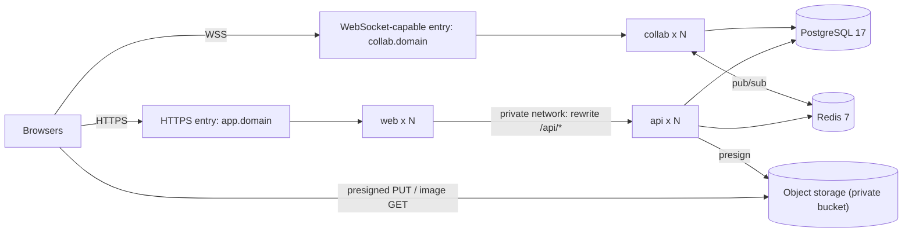

# CoNote – Deployment

**Status:** Local Phase 1a infrastructure and service shells are implemented; Phase 2 added the authentication environment variables below (not exercised in a production deployment). PostgreSQL/Redis Compose services, baseline migrations, CI and local checks have been reported successful. Production packaging/deployment and Docker app-image build are not verified; Phase 11 remains outstanding.
**Last updated:** 2026-11-21 (Phase 9: cluster settings, Redis channels, runbook, sticky-routing note; local two-instance check added to §9)

Decision IDs (`D#`, `U#`) are in [DECISIONS.md](DECISIONS.md); architecture in [ARCHITECTURE.md](ARCHITECTURE.md); protocol in [WEBSOCKET_PROTOCOL.md](WEBSOCKET_PROTOCOL.md). The production hosting target is **unresolved (U10)**, so this document is **provider-neutral**: it defines container images, topology, configuration, operations and runbooks that work on a single VM with Docker Compose or on a managed container platform. It is finalized and executed in Phase 11 (IMPLEMENTATION_PLAN AC-11.1 … AC-11.8). Production topology, hardening and runbooks below remain plans unless explicitly identified as implemented in the Phase 1a notes above.

## 1. Environments

| Environment | Purpose | Infrastructure |
|---|---|---|
| Local development | Day-to-day work | Docker Compose for PostgreSQL and Redis; apps run on the host with `pnpm`. S3-compatible storage is deferred (D37/U7) |
| CI | Automated tests | Service containers/Compose (TESTING.md §9) |
| Staging (optional, recommended before Phase 11 sign-off) | Production-like verification | Same topology as production, separate data and secrets |
| Production | Live system | Reference topology (§2) on the target chosen in U10 |

### Local Compose services and ports (from ARCHITECTURE §15)

| Service | Port(s) |
|---|---|
| `web` | 3000 |
| `api` | 4000 |
| `collab` instance 1 / 2 | 4100 / 4101 |
| PostgreSQL 17 | 5433 on the host → 5432 in the Compose container |
| Redis 7.x | 6379 |
| S3-compatible storage (MinIO if practical; not included in Phase 1 Compose, D37) | 9000 (API) / 9001 (console), when added |

## 2. Reference production topology



Rules:

1. **Only two public entry points:** `app.<domain>` (web) and `collab.<domain>` (WebSocket). The **API is private** (reachable only from `web`); object storage is accessed by browsers only through presigned URLs.
2. TLS terminates at the entry points. The collab entry must support WebSocket upgrade and long-lived connections. **Sticky sessions are not required** (D2).
3. `web` and `api` are stateless and horizontally scalable. `collab` instances are interchangeable; adding instances increases connection capacity and availability, **not per-document CPU capacity** (D2). Capacity numbers are produced in Phase 9 and not assumed.
4. PostgreSQL is the **only durable store** (D14). Redis is disposable.

## 3. Container images

| Image | Built from | Notes |
|---|---|---|
| `conote-web` | `apps/web` | Next.js production build; non-root user |
| `conote-api` | `apps/api` | Fastify; includes Prisma client; non-root |
| `conote-collab` | `apps/collab` | Hocuspocus; non-root |
| `conote-migrate` (job) | `packages/db` | Runs `prisma migrate deploy`; used as a release step |

Requirements (Dockerfiles written in Phase 11, development Dockerfiles may appear earlier):

- Multi-stage builds, pnpm workspace-aware, `pnpm install --frozen-lockfile`.
- Base image: official Node.js **24 LTS** (D16), pinned to an exact tag/digest at build time (U1).
- Run as a non-root user; read-only root filesystem where possible; no secrets baked into images.
- Images are tagged with the git commit SHA; `latest` is not used for deployment.
- Health checks distinguish liveness, service readiness and dependency health. API readiness requires PostgreSQL, not Redis; collab reports PostgreSQL readiness and Redis-degraded multi-instance capability separately (API_CONTRACTS.md §13).

## 4. Configuration

Environment variable names for shared, API, collab and web are **implemented as of Phase 1** (see `.env.example` and D40): `NODE_ENV`, `LOG_LEVEL`, `DATABASE_URL`, `REDIS_URL`, `PORT`, `APP_URL`, `ALLOWED_ORIGINS`, `COLLAB_PORT`, `API_INTERNAL_URL`, and (Phase 2) `TRUST_PROXY`, `SESSION_IDLE_TTL_DAYS`, `SESSION_ABSOLUTE_TTL_DAYS`, and (Phase 4) `ASSET_STORAGE_DIR`. All other names below remain provisional until the phase that uses them. Values shown are the initial defaults from DECISIONS.md/WEBSOCKET_PROTOCOL.md; "—" means no default and must be set. Secrets are never committed; production secrets come from the chosen secret store (platform secrets or an encrypted env file on a VM).

### Shared

| Variable | Purpose | Default |
|---|---|---|
| `NODE_ENV` | `development` / `test` / `production` | — |
| `LOG_LEVEL` | pino level | `info` |
| `DATABASE_URL` | PostgreSQL connection string | — (secret) |
| `REDIS_URL` | Redis connection string | — (secret) |

### `apps/web`

| Variable | Purpose | Default |
|---|---|---|
| `APP_URL` | Public web origin (used for invitation links and Origin checks) | — |
| `API_INTERNAL_URL` | Internal API URL used by `rewrites()` and server-side calls (D6). **Resolved at build time for the rewrite** (`next build`; `infra/Dockerfile.web` takes it as the build argument `API_INTERNAL_URL`); the runtime value is used for server-side calls | — |

### `apps/api`

| Variable | Purpose | Default |
|---|---|---|
| `PORT` | Listen port | `4000` |
| `APP_URL` | Public web origin | — |
| `ALLOWED_ORIGINS` | Origin allow-list for CSRF/CORS (D25) | `APP_URL` |
| `TRUST_PROXY` | Comma-separated proxy IPs / CIDRs / `loopback` / `linklocal` / `uniquelocal` whose `X-Forwarded-For` is trusted (D43). **Production requires a reverse proxy in front of the web app that sets `X-Forwarded-For`; the web app must be reachable only through it** (ARCHITECTURE §10.3) | empty (trust none) |
| `SESSION_IDLE_TTL_DAYS` / `SESSION_ABSOLUTE_TTL_DAYS` | Session lifetimes in days, 1–365 (D5, D42) | `7` / `30` |
| `ASSET_STORAGE_DIR` | Directory of the local-disk image storage adapter (D55). Must be a persistent volume in production and is suitable for a single API instance only; several instances need an S3-compatible adapter, which is not implemented. The Docker `apps` profile does not mount a volume for it yet, so images written there are lost when the container is recreated | `.data/assets` |
| *(not a variable)* session cookie name | `__Host-conote_session` when `NODE_ENV=production`, else `conote_session` (D42) | — |
| *(not variables)* Argon2id parameters | Fixed in code: m = 19456 KiB, t = 2, p = 1 (ARCHITECTURE §10.1). `ARGON2_*` variables were not implemented; add them only if tuning per environment becomes necessary | — |
| `INVITATION_TTL_DAYS` | Invitation lifetime (D30) | `7` |
| `PAGE_PURGE_RETENTION_DAYS` | Soft-delete retention (D24) | `30` |
| `COLLAB_PUBLIC_URL` | Collab WebSocket URL returned by `PAGE-10` | — |
| `COLLAB_JWT_PRIVATE_KEY` | Ed25519 private key (PEM) for signing collaboration tokens (D22) | — (secret) |
| `COLLAB_JWT_KID` | Key id placed in the token header | — |
| `COLLAB_JWT_TTL_SECONDS` | Token lifetime | `60` |
| `S3_ENDPOINT`, `S3_REGION`, `S3_BUCKET`, `S3_ACCESS_KEY_ID`, `S3_SECRET_ACCESS_KEY`, `S3_FORCE_PATH_STYLE` | Object storage (D10) | — (secrets) |
| `ASSET_ALLOWED_TYPES`, `ASSET_MAX_BYTES` | Upload policy | decided in Phase 4 (U7) |
| `EMAIL_ADAPTER` | `console` (default) or a provider adapter (U6) | `console` |

### `apps/collab`

| Variable | Purpose | Default |
|---|---|---|
| `COLLAB_PORT` | Listen port | `4100` |
| `COLLAB_ALLOWED_ORIGINS` | WebSocket `Origin` allow-list | web origin |
| `COLLAB_JWT_PUBLIC_KEYS` | JSON list of `{ kid, publicKeyPem }` for verification (supports rotation) | — |
| `COLLAB_REVALIDATE_INTERVAL_MS` | Periodic revalidation (D22) | `60000` |
| `COLLAB_STORE_DEBOUNCE_MS` / `COLLAB_STORE_MAX_DEBOUNCE_MS` | Store debounce (D15; names confirmed against Hocuspocus, V1) | `2000` / `10000` |
| `COLLAB_COMPACT_UPDATE_COUNT` | Compaction threshold (D15) | `200` |
| `COLLAB_CLUSTER_ENABLED` | Cross-instance synchronization through Redis (Phase 9, D64). `false` for a single instance | `true` |
| `COLLAB_INSTANCE_ID` | Name of the instance in logs and in the Redis protocol; letters, digits, `.`, `-`, `_`, at most 64. **Set a stable, unique value per instance** (a random one is made when unset) | random per process |
| `COLLAB_REDIS_PREFIX` | Prefix of the document channels. All instances of one deployment **must share it**; two deployments on one Redis must differ | `conote:collab` |
| `COLLAB_CLUSTER_INITIAL_SYNC_TIMEOUT_MS` | How long a document load waits for a peer's state (the extension's `awaitInitialSyncTimeout`, D2; replaces the earlier name `COLLAB_AWAIT_INITIAL_SYNC_MS`, which the code never read) | `1000` |
| `COLLAB_CLUSTER_RESYNC_INTERVAL_MS` | Anti-entropy interval of the U13 recovery (D64); `0` turns the timer off (the recovery after a Redis reconnection always runs) | `30000` |
| `COLLAB_CLUSTER_STORE_REPLICATED` | Also store changes that arrived from another instance (D65) | `true` |
| `COLLAB_CONNECTION_TIMEOUT_MS` | Close a connection that sent nothing for this long (heartbeat) | `60000` |
| Message-size, rate and connection-limit variables | Abuse protection (WEBSOCKET_PROTOCOL §11) | defined in Phase 6, tuned in Phase 9 |

### Redis names

| Item | Name |
|---|---|
| Access-event channel | `conote:events:access` |
| Page-event channel | `conote:events:page` |
| Rate-limit key prefix | `conote:rl:` |
| Document channels | `<COLLAB_REDIS_PREFIX>:<documentName>`, for example `conote:collab:page:<pageId>` |
| Per-instance reply channels | `<COLLAB_REDIS_PREFIX>#reply:<COLLAB_INSTANCE_ID>` |

## 5. Secrets and keys

| Secret | Handling |
|---|---|
| Database and Redis credentials, S3 keys | Stored in the platform secret store; rotated per provider guidance |
| **Collaboration JWT key pair (Ed25519)** | Generated outside the repository (e.g. with OpenSSL). The **API holds the private key**; **collab holds public keys only** (D22). Rotation: generate a new pair with a new `kid`; deploy the new public key to collab first (both `kid`s accepted), then switch the API to sign with the new key, wait longer than the token lifetime, then remove the old public key. The procedure is tested once in Phase 11 (AC-11.6). |
| Session secrets | Sessions are random opaque tokens stored hashed; there is no signing secret for sessions |

No secret appears in the repository, images, logs or CI output. `.env.example` contains placeholders only.

## 6. Reverse proxy / load balancer requirements

**Web entry (`app.<domain>`):** HTTPS only; HTTP → HTTPS redirect; forwards `X-Forwarded-For`/`-Proto`; request body limit compatible with the API's limits. Image uploads go to object storage directly, not through this entry.

**Collab entry (`collab.<domain>`):**

- WebSocket upgrade supported end-to-end; idle timeout longer than `COLLAB_CONNECTION_TIMEOUT_MS` is **not** required (the server closes silent connections itself) but the balancer's idle timeout must not be shorter than the clients' ping interval or healthy idle connections will be cut (the interval was not measured in Phase 9; check the provider settings).
- Any instance may serve any document: round-robin or least-connections is correct. Sticky routing by document would roughly halve load in the measured case but is not implemented (D67, PERFORMANCE §8).
- When an instance stops answering `/health`, stop sending it new connections; existing connections move by themselves when it closes them.
- TLS termination; forwards the `Origin` header unchanged.
- No stickiness required; connection draining supported (§9).
- Per-IP connection-rate limiting at the edge in addition to the application's limits (not done in Phase 9; the application limits are per instance and per user **per instance**: a global per-user limit does not exist, so a user can hold the per-user limit on every instance).

## 7. Data services

### PostgreSQL 17 (durable source of truth)

- Version 17 (supported by Prisma; DECISIONS D18). Managed service or self-hosted; either must provide backups.
- **Backups:** automated base backups plus continuous WAL archiving for point-in-time recovery (recommended), frequency and retention chosen in Phase 11.
- **Restore drill (required before sign-off, AC-11.3):** restore into a fresh database, run the application against it, and verify both application data and collaborative documents (load several documents, compare content). Record the restore time.
- Connection limits: size pools for `api` and `collab` instances (`collab` uses short row-locked transactions per page, DATABASE_SCHEMA §7).
- Migrations are applied only by the migrate job (§8).

### Redis 7.x (disposable)

- Used for Hocuspocus fan-out, rate limiting and access events (D2, D14). Correctness never depends on its contents.
- Persistence (RDB/AOF) is optional and not relied upon. Instances reconnect after a Redis restart, but Pub/Sub messages missed during the outage are not replayed. Each instance therefore runs the explicit recovery procedure of D64 (PostgreSQL comparison plus state-vector announcement) when Redis returns and every `COLLAB_CLUSTER_RESYNC_INTERVAL_MS`; reconnecting alone is insufficient (tested). Measured: about 1 s from Redis being back to converged documents (PERFORMANCE §5).
- Set a memory limit and an eviction policy appropriate for rate-limit counters. **Not tested in Phase 9**: the document channels carry no stored data, so eviction only affects rate-limit keys; use `noeviction` or `volatile-*` and watch the memory figure. At 3 instances and 20 changes per second on one document, Redis handled about 130 commands and 44 KB per second (PERFORMANCE §2). Protect with authentication/network isolation; TLS if it crosses untrusted networks.

### Object storage (S3-compatible)

- Private bucket; no public listing. Browsers upload with short-lived presigned URLs and read via the API's authorization redirect (`ASSET-03`).
- Bucket CORS must allow the web origin for presigned `PUT` (confirmed in Phase 4).
- Lifecycle: orphaned/pending objects cleaned by the API cleanup job; optional storage lifecycle rules.
- Local development uses MinIO if practical; its current distribution/licensing is checked in Phase 1 (U7).

## Health checks and degraded operation

- `GET /health` is liveness only: it reports whether the process is alive and does not fail because a dependency is unavailable.
- API `GET /ready` requires PostgreSQL connectivity and a compatible schema. Redis health is included as a separate dependency field; Redis failure alone does not remove the API from service.
- Collab exposes equivalent liveness and readiness diagnostics. PostgreSQL is required for safe hydration and durable stores. Redis-down is reported as `degraded` by `/ready` for multi-instance propagation. **As built, instances keep serving their own clients during an outage** (D64 item 6) rather than refusing; this is a decision awaiting the owner's acceptance.
- Redis-dependent API features must follow the scoped failure policy in API_CONTRACTS.md: bounded fallback only when explicitly safe; security-sensitive rate limits fail closed rather than silently disabling protection.
- Monitoring and load balancer decisions must use the readiness signal for the service being routed to, not a shared all-dependencies-green check.

## 8. Release procedure

1. CI passes on the commit (lint, typecheck, tests; pre-release stage for releases).
2. Build images tagged with the commit SHA; scan images and dependencies (`pnpm audit`, image scan).
3. **Run the migrate job** (`prisma migrate deploy`) against production **before** rolling out new application versions. Migrations follow an **expand → deploy → contract** pattern so the previous application version keeps working during rollout; destructive changes are done in a later release.
4. Roll out `api` and `web` (stateless; rolling update with readiness checks).
5. Roll out `collab` **one instance at a time with draining** (§9).
6. Run the production smoke test (AC-11.2).
7. Record the release in HANDOVER.md/release notes. Rollback: redeploy the previous image tag; database rollback is by forward-fix or restore, never by manual schema edits.

## 9. Collab operations

- **Graceful shutdown (SIGTERM):** the instance stops accepting connections, sends `server.shutting_down`, flushes stores for all loaded documents, closes connections with the "restarting" close code, then exits. Orchestrator termination grace period must exceed the flush time observed in Phase 9.
- **Rolling restarts:** drain one instance, wait until its replacement answers `/health` (about 0.7 s in the benchmark), then the next. Clients reconnect to any instance (D2). Tested with two instances and 4–8 clients: no typed edit was lost (TESTING §8.0e). Give the termination grace period at least a few seconds more than the one-second unload delay of the Redis extension plus the store flush; with many open documents it was not measured.
- **Redis outage:** see the runbook in §14. During the outage each instance logs `redis unavailable: cross-instance sync is paused…` once; when Redis returns it logs `redis is back: running the recovery procedure`. **`/ready` does not show the cluster state** (only whether Redis answers); alert on those log lines until a metric exists (Phase 11).
- **Kill of an instance:** its users' cursors linger about 34 s on the other instances before they expire.
- **Memory and connections (one core, light load):** about 130 MB over the idle process for 1,000 connections on 200 documents, and no connection failed at that size (PERFORMANCE §3). Do not treat this as a capacity limit.
- **Crash:** clients reconnect elsewhere; the document is rebuilt from PostgreSQL; edits not yet committed survive only in still-connected clients (G3).
- **Scaling:** add instances to raise connection capacity and availability. Because every instance handles every message for documents open on several instances, scaling does not reduce per-document load; sticky routing is the documented future optimization (D2, AC-9.9).

### Checking several collab instances on one machine (verified by the owner, 2026-11-21)

Start each instance with its own port and instance id and the same `COLLAB_REDIS_PREFIX` (the value in `.env`):

```bash
COLLAB_INSTANCE_ID=collab-1 COLLAB_PORT=4100 pnpm dev:collab
COLLAB_INSTANCE_ID=collab-2 COLLAB_PORT=4101 pnpm dev:collab
```

Both should log `cluster: "connected"`. Browsers learn the collab address from the API (`collabUrl`, taken from `COLLAB_URL`), so one API gives every browser the same instance. To pin two browsers to different instances without a load balancer, start the API with `COLLAB_URL=ws://localhost:4100`, open the first browser, restart the API with `COLLAB_URL=ws://localhost:4101` and open the second; do not reload the first browser afterwards, because a reload fetches the new address. The browser's DevTools (Network, WS) shows which port each uses. For the outage check, `docker compose -f infra/docker-compose.yml stop redis` for about ten seconds and then `start redis`; both browsers should show all text without a reload, and the collab logs should show `redis unavailable` and `redis is back`. In production a load balancer in front of the instances replaces the `COLLAB_URL` switching.

## 10. Observability

**Logging:** structured JSON (pino) with a request/connection id. Never log tokens, passwords, cookies, or document content.

**Metrics (to be exported from Phase 6/9; names provisional):**

| Area | Metrics |
|---|---|
| Collab | open connections, loaded documents, updates/s, update bytes, store success/failure count, persistence lag (PERF-05), compaction count/duration, revalidation results, rejected connections by reason |
| API | request rate, latency by endpoint group (PERF-07), error rate, rate-limit rejections |
| Dependencies | PostgreSQL connections/latency, Redis connectivity and pub/sub errors |

**Alerts (Phase 11):** service health; PostgreSQL or Redis unavailable; store failures; persistence lag beyond a threshold chosen from Phase 9 baselines; sustained connection-limit rejections; certificate expiry; backup failures.

## 11. Security hardening checklist

- [ ] TLS everywhere public; HSTS; `__Host-` cookie with `Secure` verified behind the proxy (AC-11.5)
- [ ] API not exposed publicly; collab `Origin` allow-list set
- [ ] Non-root containers, minimal images, pinned base images
- [ ] Secrets only from the secret store; key rotation procedure tested
- [ ] Rate limits configured and verified (values from Phase 2/10)
- [ ] Least-privilege database users (the application role cannot alter schema; the migrate job uses a separate role)
- [ ] Backups encrypted and restore-tested
- [ ] Dependency and image scanning in CI/CD
- [ ] Security headers (`helmet`) and CORS allow-list verified on the deployment

## 12. CI/CD (GitHub Actions configured and owner-reported passing in Phase 1a)

| Stage | Action |
|---|---|
| Pull request | Current workflow: frozen install, lint, format check, typecheck, migration deploy, unit/integration tests, production build. Broader Fast/Standard stages remain the target in TESTING.md §9 |
| Main branch | Current workflow verifies source/build; image publish/deploy is not implemented yet |
| Release | Pre-release stage, migrate job, rolling deploy, smoke test |

## 13. Hosting target options (U10 – decision needed before Phase 11)

| Option | Advantages | Considerations |
|---|---|---|
| Single VM + Docker Compose (+ managed or self-hosted PostgreSQL) | Simple, cheap, easy to reproduce | Single point of failure; manual scaling; you manage backups/patching |
| Managed container platform + managed PostgreSQL/Redis | Rolling deploys, health checks, easier scaling and backups | Provider-specific configuration; confirm WebSocket support, idle timeouts and graceful-termination controls |

Selection criteria: WebSocket support with long idle timeouts, ability to drain instances, private networking between `web` and `api`, managed PostgreSQL with PITR, S3-compatible storage availability, cost. The owner picks the target; DEPLOYMENT.md is then updated with target-specific steps.

## 14. Runbooks (outlines, completed in Phase 11)

| Situation | First actions |
|---|---|
| Collab instance down | Check health; clients reconnect automatically; restart instance; verify store logs and persistence lag; confirm documents load |
| High persistence lag or store failures | Check PostgreSQL health/locks; look for long transactions on `document_states`; reduce load; do not claim durability while stores fail (G2) |
| Redis down | Mark multi-instance collaboration degraded; PostgreSQL-backed API remains ready if its own requirements are met. Instances keep serving their own clients and keep storing in PostgreSQL; changes do not cross instances until Redis returns (cursors and edits of people on other instances stop appearing). Restore Redis. Each instance then runs the D64 recovery by itself (look for `redis is back: running the recovery procedure` and the absence of `recovery procedure failed` in the logs); no manual resync is needed. If a document still differs between instances, ask an affected client to reload (it hydrates from PostgreSQL and a peer) and report it: that would be a defect in the recovery. Do not restart all instances as a first step (that was the only repair before Phase 9). No PostgreSQL restore is needed unless integrity checks show committed data loss. |
| PostgreSQL outage | API readiness returns `503`; collab readiness returns `503` because durable hydration/stores are unavailable. Do not claim edits are durable; preserve in-memory/client state where possible, restore PostgreSQL, then verify store retries and document recovery. |
| Suspected token key compromise | Rotate key pair (§5), revoke affected sessions if needed |
| Data loss report for a document | Check persisted updates/state and snapshots; restore a snapshot via the restore procedure; compare with the G3 at-risk window description |
| Restore from backup | Follow the restore-drill procedure; verify application and collaborative data |

## 15. References

- Prisma supported databases and system requirements – https://www.prisma.io/docs/orm/reference/supported-databases · https://www.prisma.io/docs/orm/reference/system-requirements
- Hocuspocus Redis extension – https://tiptap.dev/docs/hocuspocus/server/extensions/redis
- Node.js release schedule – https://nodejs.org/en/about/previous-releases *(not fetched in Phase 0)*
- PostgreSQL continuous archiving and PITR – https://www.postgresql.org/docs/17/continuous-archiving.html *(not fetched in Phase 0)*
- Next.js rewrites – https://nextjs.org/docs/app/api-reference/config/next-config-js/rewrites *(not fetched in Phase 0)*