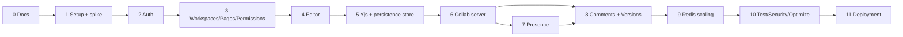

# CoNote – Implementation Plan

**Status:** Phase 1a infrastructure is complete based on owner-reported local and CI verification. Phase 1b S1–S11 execution was completed on 2026-11-12, with all eleven scenarios reporting PASS at spike level. Phase 1 closeout remains in progress: AC-1.9 evidence mapping, AC-1.10 architectural updates and owner decisions U1/U2, and AC-1.11 exclusion verification remain outstanding. Phase 2 remains blocked.

IDs used: decisions `D#`/`U#` ([DECISIONS.md](DECISIONS.md)); requirements `FR-*`, `NFR-*`, `PERF-*` ([PROJECT_MASTER.md](PROJECT_MASTER.md)); endpoints (`AUTH-01` …) ([API_CONTRACTS.md](API_CONTRACTS.md)); guarantees `G1`–`G7` and verification items `V1`–`V14` ([ARCHITECTURE.md](ARCHITECTURE.md)). Test categories are defined in [TESTING.md](TESTING.md): `UT` unit, `IT` integration, `API`, `DB`, `WS`, `CE` concurrent editing, `MB` multi-browser, `PERM` permission, `RECON` reconnection, `REC` recovery, `LOAD`, `E2E`, `SEC`, and `GT` guarantee tests (G1–G7).

Acceptance criteria are numbered `AC-<phase>.<n>`. Every criterion is a pass/fail check. No performance *targets* are set in this plan: baselines are measured (Phases 1, 5, 6, 9) and targets are then recorded as decisions (D14, PERF-*).

## 1. Cross-phase rules (Definition of Done)

A phase is complete only when **all** of these hold:

1. Every acceptance criterion of the phase passes, with evidence (test names, command output summaries or recorded results) listed in HANDOVER.md.
2. All tests required for the phase pass in CI on a clean checkout; no skipped or disabled tests without a recorded reason.
3. `pnpm lint`, `pnpm typecheck` (strict, D12) and `pnpm test` pass; module-boundary lint rules pass (ARCHITECTURE §5).
4. Documentation is updated in the same change: affected docs, new decisions in DECISIONS.md, resolved `U#`/`V#` items updated.
5. Dependencies are exactly pinned (D13); any version change is recorded.
6. No feature is described as complete in README.md/HANDOVER.md unless it is implemented and tested.
7. HANDOVER.md is updated with status, results, deviations and instructions for the next phase.
8. The owner reviews and approves the phase before the next one starts.

## 2. Roadmap overview and rationale

| Phase | Name | Depends on | Key risk reduced |
|---|---|---|---|
| 0 | Documentation and Architecture | — | Unclear requirements |
| 1 | Project Setup and Infrastructure (+ **collaboration spike**, D28) | 0 | Hocuspocus/Redis/Postgres assumptions (U3, U4) |
| 2 | Authentication and User Management | 1 | Session/cookie/proxy design (V7) |
| 3 | Workspaces, Pages and Permissions | 2 | Permission model correctness (D23) |
| 4 | Rich-Text Editor | 3 | Editor extensibility, image handling (U7) |
| 5 | Yjs CRDT Integration | 3, 4 | Document persistence correctness (G1, G2, G4) |
| 6 | WebSocket Server and Real-Time Collaboration | 5 | Auth/authorization over WebSocket (G3, G6) |
| 7 | Presence and Collaborative UI | 6 | Awareness spoofing (V14) |
| 8 | Comments and Version History | 6, 7 | Anchors and restore (D8, D9, U8) |
| 9 | Redis Scaling and Performance | 6, 8 | Multi-instance behaviour (D2, G5) |
| 10 | Testing, Security and Optimization | all above | Residual defects and vulnerabilities |
| 11 | Deployment and Final Documentation | 10 | Reproducible production setup |

**Adjustments to the originally proposed roadmap (D28):** (1) the Phase 1 spike is added; (2) Phase 5 delivers the client-side Yjs binding **and** the persistence store as a tested library, so Phase 6 can focus on the network server; (3) Phase 6 runs a **single** collab instance with production-quality auth, persistence and revocation, while the Hocuspocus Redis extension and multi-instance behaviour are Phase 9; (4) Phases 5 and 6 stay separate.

---

## Phase 0 – Documentation and Architecture

**Objectives:** Define the project, architecture, data model, APIs, protocol, plan, tests and deployment before any code exists.
**Scope:** The 12 required documents and the Mermaid architecture diagram; research of library compatibility.
**Out of scope:** Any application code or Phase 1 work.
**Deliverables:** CLAUDE.md, README.md, `docs/PROJECT_MASTER.md`, `ARCHITECTURE.md`, `DATABASE_SCHEMA.md`, `API_CONTRACTS.md`, `WEBSOCKET_PROTOCOL.md`, `DECISIONS.md`, `IMPLEMENTATION_PLAN.md`, `TESTING.md`, `DEPLOYMENT.md`, `HANDOVER.md`.
**Acceptance criteria:**

| ID | Criterion |
|---|---|
| AC-0.1 | All 12 documents exist with complete contents. |
| AC-0.2 | Every decision has a permanent ID; unresolved items are listed separately (DECISIONS.md). |
| AC-0.3 | Consistency review finds no contradictory definitions across documents, or lists the remaining issues (reported in the final Phase 0 message and HANDOVER.md). |
| AC-0.4 | Mermaid diagrams are syntactically validated. |
| AC-0.5 | Every phase below has objectives, scope, dependencies, expected files, database and API changes, acceptance criteria, testing and completion requirements. |
| AC-0.6 | The owner approves the documentation. **Phase 1 does not begin without this approval.** |

---

## Phase 1 – Project Setup and Infrastructure (including the collaboration spike)

> **Status (2026-11-12): Phase 1a infrastructure complete; Phase 1b experiments executed, with S1–S11 all passing at spike level. AC-1.8 is met. AC-1.9 is partially met; AC-1.10 and AC-1.11 remain open. See docs/spikes/phase-1-collab-spike.md and docs/HANDOVER.md.**

**Objectives:** A working, verified monorepo and local infrastructure; empirical answers to the open collaboration questions before Phases 5–9 depend on them.

**Scope**

- Repository and tooling: pnpm workspace, `tsconfig.base.json` (strict), ESLint with module-boundary rules, Prettier, Vitest configuration, `.nvmrc`/`engines`, exact version pins (D11–D13, D16, D17).
- Local infrastructure with Docker Compose: PostgreSQL 17 and Redis 7.x. S3-compatible storage/MinIO is deliberately deferred from Phase 1 (D37) and reconsidered in Phase 4 (U7).
- Application shells: `apps/web` (Next.js starter page), `apps/api` (Fastify with `OPS-01`/`OPS-02`), `apps/collab` (process shell without collaboration features), `packages/db`, `packages/shared`, `packages/editor` (empty entry points).
- CI pipeline (assumption: GitHub Actions, since the repository is on GitHub): install, lint, typecheck, test.
- Prisma 7 configuration confirmed against official docs (U5, V8).
- **Disposable spike** (`spikes/collab-poc/`, outside the workspace build, not imported by any package): two Hocuspocus instances (ports 4100 and 4101) + Redis + PostgreSQL.

**Spike scenarios** (each executed and recorded as pass / fail / observation):

| ID | Scenario | Resolves |
|---|---|---|
| S1 | Two clients on **different instances** edit the same document; both converge (cross-instance sync) | D2, G1 |
| S2 | Awareness (cursor, name) propagates across instances; behaviour when a client disconnects cleanly and when it is killed | V3 |
| S3 | A **read-only** connection: its updates are ignored; can it publish awareness; is the client informed | V3, U4, §5 of WEBSOCKET_PROTOCOL |
| S4 | Baseline persistence: row-locked diff append into `DocumentUpdate`-like rows; compaction into a state row | D15, U3 |
| S5 | Hocuspocus debounce option names, store-on-unload, and whether the store hook fires on every instance for updates arriving via Redis (duplicate rows) | V1, V2, U3 |
| S6 | **Recovery:** kill an instance mid-editing, restart, reconnect; content equals the last committed state; test with and without a surviving client | G3, G4 |
| S7 | **Redis outage:** stop Redis during editing on two instances, then restore; observe missed Pub/Sub updates and divergence, then test a candidate explicit reconnect/resynchronization procedure. Redis restart alone is not considered recovery | V4, G5, U13 |
| S8 | Prototype the Hocuspocus authentication hook with a short-lived throwaway EdDSA token; verify token is not placed in the URL and observe auth-failure close behaviour. Record reconnect token-callback capability if practical; production fresh-token acquisition belongs to Phase 6 (V6) | V5, V6, V13 |
| S9 | Client-to-server stateless message handler round trip | V12 |
| S10 | Prototype awareness identity enforcement by rejecting or rewriting a forged user id; record the mechanism and limitations. Production presence integration remains Phase 7 | V14 |
| S11 | Inspect Hocuspocus 4.8 hooks/options for message-size and connection-limit enforcement; record what is available and what must be implemented. Do not treat this as production abuse protection or load testing (V11; implementation/tuning in Phases 6/9) | V11 |

**Out of scope:** Any production collaboration feature, real user authentication/authorization, production token refresh, production presence/abuse enforcement, real application schema migrations, or performance/load certification. The spike uses throwaway tokens and a throwaway database schema; neither enters the production migration history.

**Dependencies:** Phase 0 approved.

**Files/modules expected:** root `package.json`, `pnpm-workspace.yaml`, `pnpm-lock.yaml`, `tsconfig.base.json`, `.nvmrc`, `.npmrc`, ESLint/Prettier/Vitest configs, `infra/docker-compose.yml`, `.env.example`, `.github/workflows/ci.yml`, `apps/*` and `packages/*` shells, `spikes/collab-poc/`, `docs/spikes/phase-1-collab-spike.md` (recorded results).

**Database changes:** None in the migration history (Prisma configured; the first real migration is in Phase 2). A throwaway spike schema may exist inside `spikes/collab-poc/`.

**API changes:** `OPS-01 GET /health`, `OPS-02 GET /ready`.

**Technical considerations:** Node 24 and TypeScript 5.9.3 are implemented and have passed the reported checks; owner sign-off remains pending (U1/U2). Prisma 7 monorepo setup is evidenced by client generation, real DB connectivity and successful baseline migration deploy/status (U5/V8). Resolve the exact `@tiptap/y-tiptap` pin in Phase 5; MinIO/storage remains deferred to Phase 4 (U7/D37).

**Acceptance criteria**

| ID | Criterion |
|---|---|
| AC-1.1 | `pnpm install --frozen-lockfile` succeeds on Node 24 on a clean checkout in CI. |
| AC-1.2 | Root `lint`, `typecheck` and `test` scripts exist and pass in CI. |
| AC-1.3 | A lint test proves that a deliberate forbidden import (e.g. `web` → `db`) fails the boundary rule. |
| AC-1.4 | `docker compose up` starts PostgreSQL and Redis with passing health checks; README documents the steps. Object storage is explicitly not required in Phase 1 and is deferred under D37/U7. |
| AC-1.5 | `web`, `api`, `collab` shells start. Liveness is independent of dependencies. API readiness returns `200` when PostgreSQL is healthy and schema-compatible; Redis-down status is reported separately and does not alone make the API unready. Collab readiness reports PostgreSQL and Redis independently; it reports degraded multi-instance capability when Redis is down. Tests cover each dependency independently. |
| AC-1.6 | Every pinned version in `package.json` matches PROJECT_MASTER.md §6 or the difference is recorded in DECISIONS.md; `engines` and `.nvmrc` are set. |
| AC-1.7 | Prisma client generates and connects to PostgreSQL in the monorepo; the setup is recorded (U5/V8 resolved). |
| AC-1.8 | Spike scenarios S1–S11 are each executed, with pass/fail/observation recorded in `docs/spikes/phase-1-collab-spike.md`, including environment and exact versions. |
| AC-1.9 | Record spike-level evidence for U3/U4, V1–V5, V12–V14. For V6 and V11, record the library capability/limitations observed and explicitly defer production token refresh and abuse enforcement to Phases 6/9. Every item must be marked resolved at the level tested or remain open with a reason, owner and target phase; spike observations must not be represented as production verification. |
| AC-1.10 | Architectural implications of the spike are written into DECISIONS.md/ARCHITECTURE.md/WEBSOCKET_PROTOCOL.md. U5/V8 is resolved with the Phase 1a implementation and migration evidence. U1/U2 must receive explicit owner decisions (accept Node 24 and TypeScript 5.9.3, or choose alternatives) before Phase 1 is closed. |
| AC-1.11 | The spike directory is removed (or clearly archived and excluded from builds) and no production collaboration feature code exists. |

**Phase 1b execution update (2026-11-12):** The isolated spike was executed locally using Node v24.18.0, pnpm 12.18.0, PostgreSQL and isolated Redis on port 6380. Typecheck and build passed. All scenarios S1–S11 reported PASS. The detailed evidence, limitations and observations are recorded in docs/spikes/phase-1-collab-spike.md.

AC-1.8 is met at spike level. AC-1.9 remains partial pending item-by-item review of U3/U4 and V1–V5/V12–V14. AC-1.10 remains open pending architectural documentation updates and explicit U1/U2 owner decisions. AC-1.11 remains pending root exclusion verification. Phase 2 remains blocked.

**Testing requirements:** `UT` for tooling sanity; `IT` for `/ready` behaviour; spike scenarios are manual-scripted experiments recorded in the results document (not part of the permanent test suite).

**Completion requirements:** Definition of Done (§1); spike results reviewed by the owner; spike removed or archived outside production builds; HANDOVER.md updated. Phase 2 remains blocked until the owner explicitly approves it.

---

## Phase 2 – Authentication and User Management

**Objectives:** Secure registration, login, sessions and profile; protected routes; verified same-origin proxy.

**Scope:** FR-AUTH-01 … FR-AUTH-07 (avatar upload completes in Phase 4).
**Features:** register/login/logout, session list/revoke, password change, profile (display name, presence color), route protection in web and API, rate limiting, session cleanup job.
**Out of scope:** Email verification, password reset, social login (non-goals), workspaces.

**Dependencies:** Phase 1.

**Files/modules expected:** `packages/db` (Prisma schema `User`, `Session`; first migration; check constraints), `packages/shared` (Zod schemas, error codes, response envelope), `apps/api` (auth plugin, session middleware, routes for `AUTH-*`, `USER-*`, rate limiting, request ID, error handler, cleanup job), `apps/web` (login/register pages, authenticated layout, route protection, `next.config` rewrites, API client).

**Database changes:** `User`, `Session` and constraints in DATABASE_SCHEMA §5 (users).
**API changes:** `AUTH-01`–`AUTH-07`, `USER-01`, `USER-02` (without avatar).

**Technical considerations:** Argon2id tuning on target hardware (record chosen parameters); session token generation and hashing; cookie attributes (ARCHITECTURE §10.2); `trustProxy`; **V7: verify what the Next.js rewrite forwards (`Origin`, `Host`, `X-Forwarded-*`, `Set-Cookie`)**; server-component calls with explicit cookie forwarding; uniform login errors and comparable work for unknown users; rate-limit values chosen and recorded.

**Acceptance criteria**

| ID | Criterion |
|---|---|
| AC-2.1 | Passwords are stored only as Argon2id hashes; a DB test shows no plaintext or reversible value; chosen parameters are recorded. |
| AC-2.2 | The raw session token never appears in the database (only its SHA-256 hash); a DB test confirms. |
| AC-2.3 | The session cookie has `HttpOnly`, `SameSite=Lax`, no `Domain`, `Secure` in production mode, and the `__Host-` name in production; an API test inspects `Set-Cookie`. |
| AC-2.4 | Idle expiry and absolute expiry each reject the session (tests with controlled clock); revoked sessions are rejected immediately. |
| AC-2.5 | Every `AUTH-*`/`USER-*` endpoint has tests for its success path and each documented error code. |
| AC-2.6 | Unauthenticated requests to protected API endpoints return `401 UNAUTHENTICATED`; protected web routes redirect to login (E2E). |
| AC-2.7 | State-changing requests with a disallowed `Origin` or non-JSON content type are rejected (`403 INVALID_ORIGIN`, `415`). |
| AC-2.8 | Rate limiting returns `429 RATE_LIMITED` on repeated login attempts in a test. |
| AC-2.9 | Login responses are identical in status and body shape for unknown email and wrong password. |
| AC-2.10 | Password change revokes all other sessions (test). |
| AC-2.11 | V7 is resolved: the forwarding behaviour of the rewrite is documented and covered by an integration test against the real proxy path. |
| AC-2.12 | Cleanup job removes expired sessions (test). |

**Testing requirements:** `UT` (hashing, token, validation), `DB` (constraints), `API` (all endpoints), `SEC` (cookie, CSRF, enumeration, rate limit), `E2E` (register → login → protected page → logout).
**Completion requirements:** Definition of Done; DATABASE_SCHEMA/API_CONTRACTS updated for any deviation; HANDOVER.md.

**Phase 2 status: implemented; owner-verified locally (2026-11-13); the owner reports the GitHub Actions CI run passed (recorded 2026-11-15); final owner sign-off pending.** Evidence is in HANDOVER §7. Summary against the criteria: AC-2.1 to AC-2.5, AC-2.7 to AC-2.10 and AC-2.12 are covered by automated tests that passed in the preparation environment. **AC-2.6** is met for the API and, at HTTP level (real API + real Next.js server, redirects asserted), for web routes; the plan's *browser* E2E (Playwright, D26) was **not run** (no browser could be installed in the preparation environment), and client-side behaviour is covered by jsdom component tests instead. **AC-2.11** is met: V7 was measured and the forwarding behaviour is covered by an integration test through the real rewrite; it revealed that Next.js does not set `X-Forwarded-For` (ARCHITECTURE §10.3). Scope notes: `avatarAssetId` is deferred to Phase 4 as planned; readiness now also checks that every shipped migration is applied (D35 follow-up, D41).

---

## Phase 3 – Workspaces, Pages and Permissions

> **Status (2026-11-15): implemented 2026-11-14 and owner-verified locally on 2026-11-15; D48–D53 accepted by the owner; final Phase 3 acceptance pending.** Verified by the owner: migration deploy and scratch-database drift check, lint, format check, typecheck, `pnpm check` (482 tests, including the 133-case permission matrix and the DB constraint tests against PostgreSQL and Redis) and a manual browser walkthrough (HANDOVER §8.8). Not done: browser E2E (AC-3.11 is covered by API-level flow tests and the manual walkthrough), GitHub Actions CI and the Docker `apps` profile for Phase 3. Deviations: D48 (invitee decline), D52 (deferred: invitation email adapter, development seed script, Playwright E2E; page search was never in scope).

**Objectives:** Multi-user workspaces with roles, invitations, nested pages, soft delete and page-level permissions, enforced server-side.

**Scope:** FR-WS-01 … FR-WS-08, FR-PG-01 … FR-PG-06, FR-PM-01, FR-PM-02 (REST part). Activity logging for these actions.
**Features:** workspace CRUD, members and roles, ownership transfer, link-based invitations, page tree (create, rename, icon, move, reorder, soft delete, restore, purge), permission overrides with inheritance, activity feed, web UI for all of these (page body is a placeholder until Phase 4).
**Out of scope:** Editor content, collaboration, comments, email delivery provider (U6), external guests (U9).

**Dependencies:** Phase 2.

**Files/modules expected:** `packages/db` (models for workspaces, members, invitations, pages, page permissions, activity logs; SQL constraints; effective-permission query helpers; seed script), `packages/shared` (**pure permission-resolution function**, role ordering, schemas), `apps/api` (routes `WS-*`, `INV-*`, `PAGE-01`–`PAGE-09`, `PP-*`, `ACT-*`; invitation token handling; cleanup/purge jobs; email-adapter interface with console implementation), `apps/web` (workspace switcher, member management, invitation flow at `/invite`, page tree, trash, permission dialog, activity view).

**Database changes:** `Workspace`, `WorkspaceMember`, `Invitation`, `Page`, `PagePermission`, `ActivityLog`; SQL constraints (one owner per workspace, invitation constraints, page self-parent check).
**API changes:** `WS-01`–`WS-09`, `INV-01`–`INV-06`, `PAGE-01`–`PAGE-09`, `PP-01`–`PP-03`, `ACT-01`, `ACT-02`. (`PAGE-10` collab token is Phase 6.)

**Technical considerations:** recursive CTE for effective role (DATABASE_SCHEMA §9); cycle and depth checks in the move transaction; fractional-index `position`; invitation token as URL fragment; confirm U9 stays out of scope; access-event publishing hooks exist (Redis publisher) even though consumers arrive in Phase 6.

**Acceptance criteria**

| ID | Criterion |
|---|---|
| AC-3.1 | The shared permission function has exhaustive unit tests: every combination of workspace role × page override (`NONE`/`VIEWER`/`COMMENTER`/`EDITOR`/none) × inheritance depth, including `NONE` denial and Admin/Owner non-restrictability (D23). |
| AC-3.2 | **Every cell of the permission matrix in PROJECT_MASTER §5** that applies to Phase 3 actions has an API test (role × endpoint, allowed and denied). |
| AC-3.3 | Users with no access receive `404`, users with insufficient role `403`, as specified (API test per endpoint family). |
| AC-3.4 | A database test shows a second `OWNER` row for the same workspace is rejected, and invitations with role `OWNER` are rejected. |
| AC-3.5 | Invitations are single-use, expire (test with controlled clock), are bound to the invited email, and only the token hash is stored (DB test). |
| AC-3.6 | Moving a page under itself or its descendant, across workspaces, or beyond depth 10 returns `409 INVALID_MOVE`. |
| AC-3.7 | Soft delete marks the subtree with one batch id; restore restores exactly that batch; purge cascades (DB test of cascade behaviour per DATABASE_SCHEMA §8). |
| AC-3.8 | Removing a member deletes their page overrides in that workspace in the same transaction. |
| AC-3.9 | Ownership transfer changes exactly two member rows atomically and requires the password. |
| AC-3.10 | Activity entries are written for the catalogued actions (DATABASE_SCHEMA §6) (API test per action). |
| AC-3.11 | E2E: owner creates workspace, invites a second user by link, second user accepts, owner builds a page tree and restricts a page; the second user's view reflects it. |
| AC-3.12 | U9 is confirmed out of scope and U6 is recorded (link-based invitations ship). |

**Testing requirements:** `UT`, `DB`, `API`, `PERM`, `SEC` (token handling, existence hiding), `E2E`.
**Completion requirements:** Definition of Done; permission matrix traceability table in TESTING.md filled with test ids; HANDOVER.md.

---

## Phase 4 – Rich-Text Editor

**Objectives:** A complete, extensible rich-text editor (standalone, no collaboration yet) and image upload.

**Scope:** FR-ED-01 … FR-ED-09; avatar upload (completes FR-AUTH-05).
**Features:** headings, paragraphs, bold/italic/underline, ordered/unordered lists, checklists, links, tables, slash commands, images, extension registry.
**Out of scope:** Yjs, persistence of document content (the page body is held in memory or demo content only; autosave is Phase 6), comments.

**Dependencies:** Phase 3 (pages, permissions for uploads).

**Files/modules expected:** `packages/editor` (Tiptap extension registry, base extension set, slash-command definitions, image extension, shared editor schema), `apps/web` (editor component, toolbar, slash menu, image upload UI, avatar upload UI), `apps/api` (assets routes and storage adapter), `packages/db` (`Asset` model), `packages/shared` (asset schemas, allowed types/limits).

**Database changes:** `Asset`.
**API changes:** `ASSET-01`, `ASSET-02`, `ASSET-03`; `USER-02` accepts `avatarAssetId`.

**Technical considerations:** Tiptap 3 packages pinned together (D20); StarterKit configuration that can later drop undo/redo for collaboration; image URLs use the stable `/api/v1/assets/<id>` form; presigned upload flow, content-type and size limits and key generation (U7 resolved in this phase); MinIO or alternative for local development; keyboard accessibility of toolbar and slash menu (NFR-A11Y-01).

**Acceptance criteria**

| ID | Criterion |
|---|---|
| AC-4.1 | Each of FR-ED-01 … FR-ED-08 has a component or unit test and an E2E test exercising it through the UI. |
| AC-4.2 | A test registers a custom extension through the registry without changing core editor code (FR-ED-09). |
| AC-4.3 | Image upload round trip works against object storage: authorize → upload → complete → display via `ASSET-03`; a user without `PAGE≥VIEWER` gets `404`/`401` on the image URL (API + E2E). |
| AC-4.4 | Disallowed content types and over-limit sizes are rejected at `ASSET-01` (`415`, `413`), and a mismatch at `ASSET-02` returns `409`. |
| AC-4.5 | Slash menu and toolbar are keyboard-operable (E2E keyboard test). |
| AC-4.6 | The editor's StarterKit configuration is verified to allow disabling built-in undo/redo (prepared for Phase 5). |
| AC-4.7 | U7 is resolved and recorded with the chosen limits and flow. |

**Testing requirements:** `UT`, `API` (assets), `E2E`, `SEC` (upload validation, image access control).
**Completion requirements:** Definition of Done; HANDOVER.md.

**Phase 4 status: implemented 2026-11-15 under the owner's instruction to do what is best for now; owner-verified locally 2026-11-16; D54–D56 accepted 2026-11-16; final owner acceptance pending.** Evidence and open items are in HANDOVER §9 and §9.11. Scope decisions that depart from the text above, all accepted: **D54** (interim content persistence and autosave, although "persistence of document content" was listed as out of scope), **D55** (image flow with a local-disk adapter; S3/MinIO and avatar upload deferred, so `USER-02 avatarAssetId` and the avatar part of FR-AUTH-05 are **not** done), **D56** (document schema). Summary against the criteria: AC-4.2, AC-4.4 and AC-4.6 are met by automated tests. AC-4.1 is met by component/unit tests plus the owner's manual browser walkthrough of every feature; there are **no automated** browser E2E tests (Playwright). AC-4.3 is met against the local-disk adapter (API tests and the owner's browser check of button, paste and drag-and-drop uploads), **not** against object storage. AC-4.5 is covered by jsdom keyboard tests and the owner's manual keyboard check, not an automated E2E test or a screen-reader check. AC-4.7 is only partly met (flow, limits and types recorded and accepted; production storage backend open under U7).

---

## Phase 5 – Yjs CRDT Integration

**Status (2026-11-16):** implemented and executed in a preparation environment: 802 tests pass (unit and integration), typecheck and lint clean. Verified on the owner's machine on 2026-11-16 (HANDOVER §10.9: 802 tests, no defects); D57 accepted. See HANDOVER §10.8 for the per-criterion status and the fixes the preparation run needed.

**Objectives:** Bind the editor to Yjs and build the durable document store as a tested library, proving G1, G2 and G4 **without any network server**.

**Scope:** FR-RT-01, client-side part of FR-RT-03, FR-SC-02 (store). No WebSocket server (Phase 6).
**Features:** Tiptap Collaboration binding to a `Y.Doc`; Yjs encode/decode utilities; document store module (`load`, `appendDiff`, `compact`) in `packages/db`; recovery from state plus updates.
**Out of scope:** Hocuspocus server, authentication over WebSocket, presence UI, snapshots/versions, comments.

**Dependencies:** Phases 3 and 4.

**Files/modules expected:** `packages/editor` (collaboration configuration, Y.Doc binding), `packages/db` (`DocumentState`, `DocumentUpdate` models, document store with row-locked transactions via raw queries, compaction), `packages/shared` (document-name helpers, constants), test harness utilities (Yjs client harness for CE tests).

**Database changes:** `DocumentState`, `DocumentUpdate`; check constraint on update size > 0.
**API changes:** none.

**Technical considerations:** confirm the exact Yjs binding package for the pinned Tiptap (V9, `@tiptap/y-tiptap`); the persisted-state-vector **per-client maximum merge** (ARCHITECTURE §8.2); empty-document initialization; lock behaviour (`FOR UPDATE`) and Prisma raw-query usage; measuring document load time against update count (PERF-06 baseline recorded, no target).

**Acceptance criteria**

| ID | Criterion |
|---|---|
| AC-5.1 | Two editors bound to two separate `Y.Doc`s exchanging updates in a test converge to identical content after concurrent edits (CE test, G1). |
| AC-5.2 | A randomized convergence test (seeded, many replicas, random operations, random delivery order and duplication) always converges; failures print the seed. |
| AC-5.3 | `appendDiff` writes only the diff since the persisted vector; a test asserts that storing an unchanged document inserts no row and that row size is proportional to the change, not the whole document. |
| AC-5.4 | Two concurrent `appendDiff` calls on the same page serialize (row lock) and persist all content with no loss (DB/IT test with parallel transactions). |
| AC-5.5 | The persisted vector after interleaved stores from two simulated instances equals the union of both (per-client max merge test). |
| AC-5.6 | Recovery: for random histories, `load` (state + updates after `foldedSeq`) equals the original live document byte-for-content (REC test, G4). |
| AC-5.7 | Compaction is atomic: with an injected failure mid-compaction the previous state and rows are unchanged; after success `load` yields the same document (G4). |
| AC-5.8 | A test demonstrates the commit boundary: content in a live `Y.Doc` that has not been stored is absent after a simulated crash, and present after a committed store (G2). |
| AC-5.9 | PERF-06 baseline (load time vs update count) is measured and recorded with environment details. |
| AC-5.10 | V9 resolved (binding package and versions recorded). |

**Testing requirements:** `UT`, `DB`, `IT`, `CE`, `REC`, `GT` (G1, G2, G4 evidence).
**Completion requirements:** Definition of Done; ARCHITECTURE §8 amended if tests disprove any assumption; HANDOVER.md.

---

## Phase 6 – WebSocket Server and Real-Time Collaboration

**Status (2026-11-18):** implemented 2026-11-17, executed in a preparation environment (878 tests) and verified on the owner's machine on 2026-11-18 (HANDOVER §11.11: install, lint, format check, typecheck, 878 tests, and a manual real-browser walkthrough); D58–D60 accepted 2026-11-18; final owner acceptance pending. Against the criteria: AC-6.1 to AC-6.9 are covered by automated tests that pass on the owner's machine (TESTING §8.0e); the main behaviours (live sync between two browsers, Viewer downgrade, removal while open, collab restart, browser offline, a Phase 4 page, a two-minute idle) were also checked by hand (the revocation delay of AC-6.7 was observed, not measured in seconds). AC-6.10 is **not met**: no PERF-01 or PERF-05 baseline was measured (HANDOVER §11.5). AC-6.11 is **not separately recorded**: the behaviours are exercised by the tests, but no item-by-item resolution of V1, V5, V6, V11 and V13 was written down. Automated browser E2E (Playwright) was not written; the two-browser evidence is the jsdom tests plus the owner's manual run.

**Objectives:** A production-quality single-instance collaboration server with authentication, authorization, persistence, recovery, revocation and reconnection.

**Scope:** FR-RT-02, FR-RT-03, FR-RT-04, FR-RT-05, FR-RT-06, FR-PG-07, FR-PM-02 (WebSocket part), FR-PM-03, FR-PM-04 (single-instance part), FR-SC-02, FR-SC-04.
**Features:** Hocuspocus server in `apps/collab`; `PAGE-10` token issuing; authentication hook; read-only enforcement; load/store using the Phase 5 store; compaction triggers; periodic revalidation; Redis access-event consumer; graceful shutdown; web provider integration with reconnection, banners and unsynced-changes warning; autosave.
**Out of scope:** Hocuspocus Redis extension and multi-instance operation, presence UI, comments, versions.

**Dependencies:** Phase 5.

**Files/modules expected:** `apps/collab` (server, hooks, auth, persistence adapter, event subscriber, config, logging), `apps/api` (`PAGE-10`, EdDSA signing with `jose`, key configuration, access-event publishers wired), `packages/shared` (token claims schema, application-message schemas, close reasons), `apps/web` (provider hook, connection status UI), key-generation script/documentation.

**Database changes:** none (Phase 5 tables); optional index adjustments from measurements.
**API changes:** `PAGE-10`.

**Technical considerations:** token claims and verification (D22); token function for fresh tokens on reconnect (V6); close-code mapping (V13); debounce settings confirmed (V1); message size limits (V11); `onStateless` not yet required (versions are Phase 8) but the message envelope and schema validation are built; Redis is used only for access events in this phase; per-connection context; logging without content or tokens.

**Acceptance criteria**

| ID | Criterion |
|---|---|
| AC-6.1 | Connections with a valid token to an accessible page succeed; each of: expired token, bad signature, wrong `aud`, wrong `iss`, `pid` mismatch, deleted page, session revoked, `NONE` access is rejected with the documented close reason (WS tests). |
| AC-6.2 | Viewer and Commenter connections are read-only: updates they send are not applied, broadcast or persisted (verified by checking other clients and the database) (WS + PERM tests, G6). |
| AC-6.3 | N concurrent clients (N chosen in TESTING.md) performing randomized edits converge, and after a flush the persisted document equals the live document (CE + GT G1). |
| AC-6.4 | Autosave: edits become committed rows without a user action; the store is triggered by debounce and on last-client disconnect (verified in DB). |
| AC-6.5 | Recovery: killing and restarting the collab process mid-editing, then reconnecting, yields the last committed content (G4); a test with a surviving client shows the unsynced edits are re-sent and preserved; a test with no surviving client documents which edits are lost (G3 evidence, honest result recorded). |
| AC-6.6 | Reconnection: after a simulated network drop, the client obtains a new token, reconnects and re-syncs; edits made while offline merge (RECON tests). |
| AC-6.7 | Revocation: member removal, role downgrade, session revocation, page deletion and permission change take effect on open connections via events, and via periodic revalidation when the event is suppressed in the test; the measured delay is recorded (G6). |
| AC-6.8 | Malformed Yjs updates, oversized messages, unauthorized document names and invalid application messages are rejected/closed as specified without crashing the server (SEC/WS tests). |
| AC-6.9 | Graceful shutdown flushes stores for all loaded documents (test). |
| AC-6.10 | Baselines for PERF-01 and PERF-05 on a single instance are measured and recorded (no targets). |
| AC-6.11 | V1, V5, V6, V11, V13 resolved against the production server. |

**Testing requirements:** `WS`, `CE`, `PERM`, `RECON`, `REC`, `SEC`, `GT` (G1–G4, G6 evidence), `IT`, `E2E` (two browsers editing one page).
**Completion requirements:** Definition of Done; WEBSOCKET_PROTOCOL.md updated with confirmed behaviour; HANDOVER.md.

---

## Phase 7 – Presence and Collaborative UI

**Status (2026-11-19):** implemented 2026-11-18 and executed in a preparation environment (HANDOVER §12); owner-verified locally on 2026-11-19, including a manual check in real browsers (HANDOVER §12.11); D61 accepted. Not done: the automated two-browser Playwright test (AC-7.1), Docker, CI, final owner acceptance.

**Objectives:** Make collaboration visible: avatars, carets, selections, collaborator list and join/leave notifications, with spoof-resistant identity.

**Scope:** FR-PR-01 … FR-PR-05.
**Features:** avatar stack, colored carets with names, selection highlighting, online list (deduplicated by user), join/leave notifications with grace period, connection state UI polish.
**Out of scope:** Comments, versions, multi-instance behaviour.

**Dependencies:** Phase 6.

**Files/modules expected:** `packages/editor` (caret/selection rendering configuration), `apps/web` (presence components, notifications), `apps/collab` (awareness identity enforcement hook), `packages/shared` (awareness state schema).

**Database changes:** none. **API changes:** none (member data already available via `WS-06`).

**Technical considerations:** awareness identity binding and REST-based name/color lookup (V14); behaviour of read-only connections' awareness (U4 outcome applied); awareness size limits; deduplicating multiple tabs; colors from `presenceColor`.

**Acceptance criteria**

| ID | Criterion |
|---|---|
| AC-7.1 | In a two-browser Playwright test, each user sees the other's caret, name label and selection within the test's wait budget (MB test); each of FR-PR-01 … FR-PR-05 has a test. |
| AC-7.2 | The online list shows one entry per user when the same user has two tabs open; leaving one tab does not trigger a leave notification; closing both does. |
| AC-7.3 | A client that forges another user's `user.id` in awareness is rejected/dropped by the server, and a client that forges `name`/`color` does not change how others see it (SEC test, V14). |
| AC-7.4 | Presence entries disappear after a client disconnects cleanly and after a client is killed (within the verified awareness timeout, recorded). |
| AC-7.5 | Viewers and commenters appear in presence according to the U4/V3 outcome, documented. |
| AC-7.6 | Presence UI is keyboard-accessible where interactive (NFR-A11Y-01 check). |

**Testing requirements:** `MB`, `SEC`, `E2E`, `UT`.
**Completion requirements:** Definition of Done; WEBSOCKET_PROTOCOL.md §6 updated; HANDOVER.md.

---

## Phase 8 – Comments and Version History

**Objectives:** Anchored comment threads and a complete, safe version history.

**Scope:** FR-CM-01 … FR-CM-06, FR-VH-01 … FR-VH-06.
**Features:** comment threads anchored with Yjs Relative Positions, replies, resolve/reopen, delete, highlights, detached-thread display; automatic and manual snapshots; version list and read-only view; restore as a new transaction with pre-restore snapshot; contributor tracking via activity.
**Out of scope:** Per-keystroke authorship, suggestion mode, external sharing.

**Dependencies:** Phases 6 and 7.

**Files/modules expected:** `packages/db` (`DocumentSnapshot`, `CommentThread`, `Comment`; snapshot helpers), `apps/api` (`CMT-*`, `VER-01`–`VER-03`, Redis `page` channel publisher), `apps/collab` (`version.create`/`version.restore` handlers, operation lock, auto-snapshot rules, `page.edited` throttled activity, restore procedure, anchor re-resolution after restore, `comments.changed` forwarding), `packages/shared` (message schemas for versions), `packages/editor` (anchor helpers, comment decorations), `apps/web` (comment sidebar, version history UI).

**Database changes:** `DocumentSnapshot`, `CommentThread`, `Comment`; comment body check constraint.
**API changes:** `CMT-01`–`CMT-06`, `VER-01`–`VER-03`. WebSocket: `version.create`, `version.restore` and server events (WEBSOCKET_PROTOCOL §7–8).

**Technical considerations:** relative-position encoding and size limits; detached anchors (U8 resolved); auto-snapshot rules finalized and recorded (D-level update); retention policy decided (U11); per-page operation lock (advisory lock) across instances; V10 (applying a server-side transaction to the live document); commenter flow over a read-only connection.

**Acceptance criteria**

| ID | Criterion |
|---|---|
| AC-8.1 | Anchors follow content: after concurrent insertions before and inside the anchored range by other clients, the resolved range still covers the original text (CE test). |
| AC-8.2 | A Commenter on a read-only connection can create, reply to, resolve and reopen threads; a Viewer cannot (PERM + API tests). |
| AC-8.3 | If anchored text is deleted, the thread is retained and shown as detached with its quoted text. |
| AC-8.4 | Manual snapshot creation and restore work only over a read-write connection; others receive `FORBIDDEN` (WS tests). |
| AC-8.5 | **Restore safety (G7):** a pre-restore snapshot always exists before restore content is applied; if its creation fails the restore aborts and the document is unchanged (fault-injection test); existing snapshots are never deleted or modified (DB test). |
| AC-8.6 | **Restore convergence:** with clients connected across two collab instances, the durable restore barrier freezes/rejects new updates, drains and commits all updates accepted before the barrier, and all clients converge to the restored version after release. New edits made after release then converge normally. No pre-barrier accepted update is silently discarded (CE + REC tests, G1/G2). |
| AC-8.7 | A second `version.restore` during an active one returns `CONFLICT`. |
| AC-8.8 | Version list, detail and binary state endpoints enforce `PAGE≥VIEWER`; the state loads into a read-only viewer that matches the stored snapshot (API + E2E). |
| AC-8.9 | Contributors on a snapshot equal the distinct users with `page.edited` entries since the previous snapshot (test). |
| AC-8.10 | `comments.changed` reaches connected clients, and clients refetch after reconnect to recover missed events. |
| AC-8.11 | U8, U11 and V10 resolved and recorded. |

**Testing requirements:** `CE`, `PERM`, `API`, `WS`, `DB`, `GT` (G1, G7), `E2E`, `SEC`.
**Completion requirements:** Definition of Done; DATABASE_SCHEMA/API/WEBSOCKET docs updated; HANDOVER.md.

---

## Phase 9 – Redis Scaling and Performance

**Objectives:** Run multiple collab instances correctly; measure performance; add connection management.

**Scope:** FR-SC-01, FR-SC-03, FR-SC-04, FR-PM-04 (multi-instance); performance baselines for PERF-01 … PERF-07.
**Features:** Hocuspocus Redis extension integration; multi-instance access-event handling; connection limits, heartbeats; load-test harness; compaction and debounce tuning from measurements; reconnection storm behaviour; documented sticky-routing evaluation.
**Out of scope:** Sharding, other databases, autoscaling logic beyond documentation.

**Dependencies:** Phases 6 and 8.

**Files/modules expected:** `apps/collab` (Redis extension configuration, connection manager, limits, metrics), `infra/` (multi-instance compose, load balancer config for WebSocket), load-test harness (Node Yjs clients), `docs/` updates with recorded measurements.

**Database changes:** only index/tuning changes justified by measurements.
**API changes:** none required.

**Technical considerations:** all-instances-handle-all-messages behaviour (D2) and its measured impact; redundant persistence rows (V2 outcome); Redis Pub/Sub missed-message detection and explicit recovery procedure (U13/G5); event handling on all instances; graceful drain during rolling restarts; setting performance targets only after measurement.

**Acceptance criteria**

| ID | Criterion |
|---|---|
| AC-9.1 | With two (and then three) collab instances, clients on different instances converge under randomized concurrent edits (CE + GT G1). |
| AC-9.2 | Awareness propagates across instances; cursor and presence behave as in single-instance tests (MB test). |
| AC-9.3 | Each persistence guarantee is verified in the multi-instance setting: stores from several instances never lose committed content (G2, G4); recovery after killing any one instance preserves committed content. |
| AC-9.4 | Redis outage test disconnects one subscriber while the other instance publishes updates. The test proves PostgreSQL durability for committed updates, detects that the disconnected instance missed Pub/Sub messages, executes the selected U13 recovery procedure (forced client reconnect from PostgreSQL-hydrated state or verified server-to-server reconciliation), and proves convergence afterward. Redis reconnection alone is explicitly tested as insufficient. Record any uncommitted-update loss within G3's stated window (G5). |
| AC-9.5 | Access events and periodic revalidation work across instances: a permission change made via the API closes/downgrades the connection on whichever instance holds it (PERM tests, G6). |
| AC-9.6 | Connection limits and heartbeat behaviour are implemented and tested (per user, per instance); rejection uses the documented close reason. |
| AC-9.7 | Load tests are executed and **all** of PERF-01 … PERF-07 are measured and recorded with environment, load profile and raw results; the observed limits are written into TESTING.md and DECISIONS.md as proposed targets for owner approval. No numbers are claimed beyond what was measured. |
| AC-9.8 | Graceful rolling restart: restarting instances one at a time keeps documents available and loses no committed content (REC test). |
| AC-9.9 | Sticky-routing evaluation is written up with measured evidence and a recommendation (decision recorded). |

**Testing requirements:** `LOAD`, `CE`, `REC`, `RECON`, `PERM`, `MB`, `GT` (G1–G6 evidence in multi-instance setting).
**Completion requirements:** Definition of Done; ARCHITECTURE §9 and TESTING.md updated with measured results; HANDOVER.md.

---

## Phase 10 – Testing, Security and Optimization

**Objectives:** Close coverage gaps, harden security, optimize based on measurements, and verify that every claimed guarantee has passing tests.

**Scope:** Whole system: test completeness against traceability tables, security review, dependency audit, optimization, retention implementation (U11), accessibility pass for core flows.
**Features:** full regression suite; security test suite; optimization of measured hot spots; log and metrics review; retention/pruning jobs; final fixes.
**Out of scope:** New product features.

**Dependencies:** Phases 1–9.

**Files/modules expected:** test suites across packages, security test suite, CI pipeline extension (e2e, nightly load), optimization changes, retention jobs, security review document (recorded in HANDOVER.md or `docs/`).

**Database changes:** optimization indexes only, justified by measurements; retention jobs.
**API changes:** none (bug fixes only).

**Technical considerations:** requirement and endpoint traceability (every `FR-*`, endpoint id and guarantee has tests); dependency audit (`pnpm audit`) and review of pinned versions; rate-limit value review; error-message and log review (no tokens/content); permission matrix re-verification; WebSocket abuse tests.

**Acceptance criteria**

| ID | Criterion |
|---|---|
| AC-10.1 | The traceability tables in TESTING.md show at least one passing test for every `FR-*` requirement, every endpoint id, and each of G1–G7. Gaps are zero or explicitly accepted by the owner. |
| AC-10.2 | The full CI suite (unit, integration, API, DB, WebSocket, concurrent editing, permission, reconnection, recovery, security, E2E) passes on a clean checkout. |
| AC-10.3 | The security checklist (NFR-SEC-01 … 05, WEBSOCKET_PROTOCOL §12, ARCHITECTURE §10) is completed with evidence for each item; open findings are listed with severity and owner decision. |
| AC-10.4 | `pnpm audit` results are reviewed; known vulnerabilities are fixed or documented with justification. |
| AC-10.5 | Optimizations are each justified by a before/after measurement of the relevant PERF metric; regressions fail the suite. |
| AC-10.6 | Retention jobs for AUTO snapshots and activity logs are implemented and tested per the U11 decision. |
| AC-10.7 | Core flows (login, page tree, editor toolbar, slash menu, comments panel, version history) pass a keyboard-operability check. |
| AC-10.8 | Guarantee statements in README/ARCHITECTURE are re-checked: each claimed guarantee links to its passing tests, and no claim exceeds the evidence. |

**Testing requirements:** all categories; `GT` complete.
**Completion requirements:** Definition of Done; HANDOVER.md with final test and security status.

---

## Phase 11 – Deployment and Final Documentation

**Objectives:** A reproducible production deployment and truthful final documentation.

**Scope:** production images, deployment on the chosen target (U10), CI/CD, secrets and key management, TLS and WebSocket routing, backups and restore drill, monitoring and logging, runbooks, documentation finalization.
**Out of scope:** New features, scaling beyond documented limits.

**Dependencies:** Phase 10; U10 decided; U6 production email provider decided (if email delivery is enabled).

**Files/modules expected:** production Dockerfiles for `web`, `api`, `collab`; deployment manifests/compose for the chosen target; CI/CD workflows; environment and secrets templates; `docs/DEPLOYMENT.md` finalized; runbooks; final README.

**Database changes:** none beyond migrations already created; migration deployment procedure.
**API changes:** none.

**Technical considerations:** migration strategy at deploy time; key generation and rotation for collaboration JWT (`kid`); WebSocket-capable load balancer configuration; `trustProxy`; cookie `Secure`/`__Host-` verification behind TLS; PostgreSQL backups (the durable source of truth, D14) and a restore drill; Redis treated as disposable; health/readiness endpoints in orchestration; log aggregation without sensitive data.

**Acceptance criteria**

| ID | Criterion |
|---|---|
| AC-11.1 | Following DEPLOYMENT.md from a clean environment produces a running deployment (executed once and recorded, ideally by a person other than the author). |
| AC-11.2 | Production smoke test passes: register, login, create workspace, create page, two browsers collaborate with persisted content, comment, snapshot, restore. |
| AC-11.3 | A PostgreSQL backup is taken and restored into a fresh database; application data **and** collaborative documents are verified after restore; the restore time is recorded. |
| AC-11.4 | A collab restart in production preserves committed content (REC check against the deployed stack). |
| AC-11.5 | Production cookie attributes, TLS, WebSocket `Origin` checks, CORS and security headers are verified (SEC checks against the deployment). |
| AC-11.6 | Secrets are supplied by the chosen secret mechanism; none are committed; key rotation procedure is documented and tested once. |
| AC-11.7 | Monitoring and alerts exist for service health, PostgreSQL and Redis availability, store failures and persistence lag (PERF-05). |
| AC-11.8 | Final documentation review: README, ARCHITECTURE, API, schema, protocol, TESTING and DEPLOYMENT match the implemented system; known limitations (WEBSOCKET_PROTOCOL §14) are listed. |

**Testing requirements:** `E2E` smoke on production-like stack, `SEC`, `REC`.
**Completion requirements:** Definition of Done; HANDOVER.md final; owner sign-off.

---

## 3. Risk register (carried through the phases)

| Risk | Mitigation | Phase |
|---|---|---|
| Hocuspocus behaviour differs from assumptions (store hooks, awareness, read-only) | Phase 1 spike; design changes recorded before dependent phases | 1 |
| Redis-based scaling does not reduce per-document CPU (D2) | Measure in Phase 9; evaluate sticky routing | 9 |
| Prisma 7 / Node 24 / TypeScript toolchain surprises (U2, U5) | Verify in Phase 1; conservative TypeScript pin (D17) | 1 |
| Lost edits in the at-risk window (G3) | Defined and tested; UI claims limited to sync state; unsynced-changes warning | 6 |
| Stale permissions on open connections (G6) | Event-driven plus periodic revalidation; tests | 6, 9 |
| Restore supersedes concurrent edits | Pre-restore snapshot; restore-started message; documented limitation | 8 |
| Awareness spoofing | Identity binding; REST-based names/colors | 7 |
| Document growth (updates, snapshots) | Compaction; retention policy (U11); measurements | 5, 9, 10 |