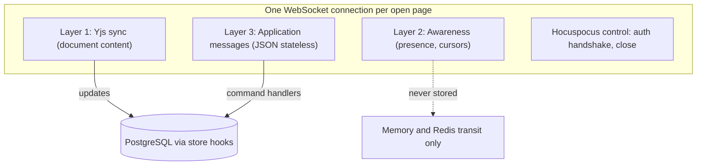
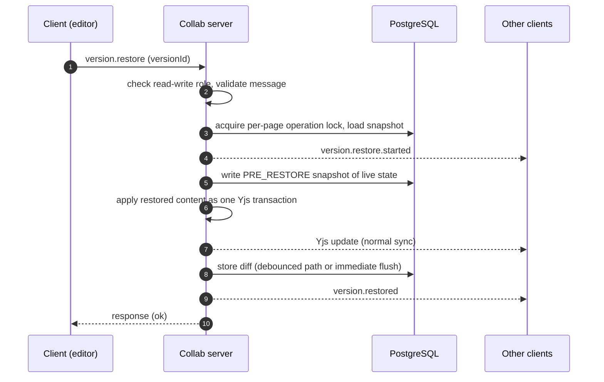

# CoNote – WebSocket Protocol

**Status:** Protocol design only. (Phase 3 note: the REST API now publishes the §10 access events `member.role_changed`, `member.removed`, `workspace.deleted` and `page.access_changed` to Redis after commit; nothing consumes them until Phase 6.) The Phase 1 collab process shell and health endpoints exist, but every document connection is deliberately rejected; no CoNote collaboration protocol feature is implemented. The disposable Phase 1b harness is prepared under `spikes/collab-poc/`, but S1–S11 have not yet been executed; all runtime-dependent statements below remain subject to the verification register.
**Last updated:** 2026-11-19
**Phase 7 note (2026-11-18):** presence (Yjs awareness, carets, selections, online list, join/leave notices) is implemented; §18 records what the server and client do. It replaces the Phase 6 rule that awareness is discarded (§17) and refines §6 (identity is stamped by the server, D61, accepted 2026-11-19). The owner verified presence locally in real browsers on 2026-11-19 (HANDOVER §12.11).
**Phase 6 note (2026-11-17):** the WebSocket server, authentication, permission enforcement, revalidation, reconnection handling and the web client are implemented and were owner-verified locally on 2026-11-18 (HANDOVER §11.11); §17 records what was built and where it differs from the design above. §§1–16 are otherwise unchanged.
**Phase 5 note (2026-11-16):** no WebSocket feature exists yet. §5a records what Phase 5 implemented at the Yjs level (sync step 1/2 as library functions, local/remote update handling, seeding rule) so Phase 6 can wrap it in the wire protocol; it was executed in a preparation environment on 2026-11-16 (HANDOVER §10.8) but no wire protocol exists yet.

Decision IDs (`D#`, `U#`) are in [DECISIONS.md](DECISIONS.md); guarantees `G1`–`G7` and verification items `V#` are in [ARCHITECTURE.md](ARCHITECTURE.md) (§8, §18). REST contracts are in [API_CONTRACTS.md](API_CONTRACTS.md).

Items marked **(to verify)** depend on Hocuspocus 4.8 behaviour that has not been tested in the CoNote Phase 1b spike; the spike or named later phase must confirm them before they are relied on.

## 1. Overview and message layers

CoNote uses **Hocuspocus 4.x** as the collaboration server and `HocuspocusProvider` as the client (D1). The wire format of Hocuspocus and Yjs is owned by those libraries; **CoNote does not implement or modify it**. CoNote defines only: the connection and authentication contract, the permission behaviour, and a small JSON message set for application events.

Three layers share one WebSocket connection and must never be mixed:

| Layer | Carries | Owner | Persisted? |
|---|---|---|---|
| **1. Yjs sync** | Document updates (sync step 1/2 and incremental updates) | Yjs / y-protocols via Hocuspocus | Yes, by the server persistence hooks (D15) |
| **2. Awareness** | Ephemeral presence: user identity, cursor, selection | Yjs awareness via Hocuspocus | Never |
| **3. Application messages** | Document-scoped events and commands (JSON over Hocuspocus *stateless* messages, D32) | CoNote | Not as messages; effects are persisted by their handlers |

Hocuspocus also has its own connection-control messages (authentication handshake, close events). These are part of the library, not of CoNote's application layer.



## 2. Endpoints and names

| Item | Value |
|---|---|
| WebSocket URL | `wss://collab.<domain>/` (production); `ws://localhost:4100/` and `:4101` (local, two instances) |
| Document name | `page:<pageId>` where `<pageId>` is the page UUID. Validated against `^page:[0-9a-f]{8}-[0-9a-f]{4}-[0-9a-f]{4}-[0-9a-f]{4}-[0-9a-f]{12}$`; anything else is rejected as a protocol violation. |
| Documents per connection | One open page = one document provider. Whether providers share a socket is a client implementation detail. |
| Cookies | **Not used.** The collab origin is separate from the web origin (D6); authentication is by collaboration JWT only. |

## 3. Connection establishment

1. The client obtains a collaboration token: `POST /api/v1/pages/:pageId/collab-token` (`PAGE-10`; requires session and `PAGE≥VIEWER`).
2. The client opens the WebSocket to the collab URL returned in the response, using `HocuspocusProvider` with the document name and the token (a static value or a function returning a fresh token; function support **to verify – V6**).
3. **Transport:** TLS (`wss`) is required in production. The load balancer terminates TLS and supports WebSocket upgrades; sticky sessions are **not required** (D2).
4. **Origin check:** the collab server validates the `Origin` header of the upgrade request against the allow-list (D25) and rejects other origins before authentication.
5. **Authentication timeout:** a socket that does not complete authentication within a short, configurable timeout is closed (value set in Phase 6).
6. The token is carried in the provider's authentication message, **not in the URL** (to verify – V5), so it does not appear in access logs.

## 4. Authentication and authorization (D7, D22)

The collab server's authentication hook runs for every document the client opens.

**Token verification** (all must pass; any failure rejects the connection):

| Check | Rule |
|---|---|
| Signature | EdDSA (Ed25519) against the configured public key(s); key selected by `kid` |
| `iss` / `aud` | `conote-api` / `conote-collab` |
| `exp` / `iat` | Not expired; `iat` not in the future beyond a small clock-skew allowance |
| `pid` | Equals the page id in the requested document name |
| `jti` | Present (used for logging and optional replay detection; replay within the 60 s lifetime is accepted as low risk, see §14) |

**Authoritative checks against PostgreSQL** (the role in the token is never trusted):

1. The session `sid` exists, is not revoked and is within `expiresAt`/`absoluteExpiresAt`.
2. The page exists and is not soft-deleted.
3. The effective page role for the user is computed with the shared pure function (D23).

**Outcome:**

| Effective role | Result |
|---|---|
| `NONE` / no membership / page missing or deleted | Rejected (close reason `ACCESS_DENIED` or `PAGE_NOT_FOUND`) |
| `VIEWER`, `COMMENTER` | Connection accepted **read-only** |
| `EDITOR`, `ADMIN`, `OWNER` | Connection accepted **read-write** |

The server stores per connection: `{ userId, sessionId, pageId, role, readOnly, connectedAt }`. This context is used by every later check and never read from client messages.

## 5. Document subscription and synchronization

1. After authentication, the server loads the document if not already in memory on this instance: hydrate from `DocumentState` plus `DocumentUpdate` rows with `seq > foldedSeq` (ARCHITECTURE §8.4). If the document is open on another instance, loading waits for that instance's state up to `awaitInitialSyncTimeout` (default 1000 ms) (D2).
2. **Sync handshake (Yjs):** both sides exchange state vectors and the updates the other lacks. A reconnecting client therefore sends edits the server has not seen, and receives edits it missed.
3. After the handshake, incremental Yjs updates flow in both directions.
4. The server broadcasts each accepted update to the other connections of the document on this instance; the Redis extension forwards it to other instances (§10). This forwarding is best-effort Pub/Sub, not a replayable log.
5. **Persistence** is triggered by Hocuspocus's debounced store hook and by document unload, writing diffs to PostgreSQL (D15, G2). Clients receive no acknowledgment of durability; "saved" indicators in the UI mean *synced with the server*, not *committed to PostgreSQL*, and the UI must not claim more.

### Read-only enforcement

- The server **ignores** document updates from read-only connections: they are neither applied, broadcast nor persisted. Hocuspocus's read-only connection mode provides this (D1, Phase 1 spike confirms behaviour and whether the client is informed of dropped updates).
- The client also disables editing (defence in depth and UX), but server enforcement is the control (G6).
- Commenters need only read-only access: comments are REST (D8, FR-CM-06).

### Redis outage and resynchronization

Redis Pub/Sub does not retain or replay messages missed by a disconnected instance. Therefore:

1. During an outage, cross-instance live propagation is degraded; clients connected to different instances may temporarily diverge.
2. Redis becoming available again does not, by itself, repair documents already loaded in memory on both instances.
3. Phase 9 must implement a stale-document detection and recovery path. The baseline is to fence/mark affected documents, stop serving known-stale state, flush any state that can safely be committed, then force clients to reconnect to a document freshly hydrated from PostgreSQL. A surviving client can send its own uncommitted Yjs updates during the normal handshake. A server-to-server reconciliation alternative requires equivalent proof.
4. Until that mechanism is implemented and tested, the system must report degraded collaboration and must not claim automatic reconvergence.

## 5a. Yjs-level synchronization implemented in Phase 5 (library only)

`DocumentReplica` (`packages/shared/src/yjs.ts`) provides the Yjs operations that the sync layer of §5 carries, without any transport:

| Wire step (y-protocols) | Library function |
|---|---|
| Sync step 1 (client sends its state vector) | `replica.stateVector()` |
| Sync step 2 (peer answers with what is missing) | `replica.diffSince(remoteStateVector)` |
| Incremental update | reported by `onLocalUpdate(update)` for every local transaction |
| Receiving step 2 or an incremental update | `replica.applyRemoteUpdate(update)` |

Rules fixed by Phase 5 for Phase 6:

1. **Origins.** Remote updates are applied with origin `REMOTE_ORIGIN`, hydration from storage with `STORE_ORIGIN`; neither is reported as a local update, so an update is never echoed back to its sender.
2. **Duplicates and order.** Applying an update twice, or out of order, is safe; an update whose dependencies are missing stays pending (`hasPendingUpdates()`) and integrates when they arrive. The server must still authenticate and size-limit every message before it reaches Yjs: Yjs does not specify its behaviour on arbitrary bytes, and Phase 5 deliberately does not test it.
3. **Initial content.** A page with no Yjs state is seeded **on the server only**, once, through `DocumentStore.seedIfEmpty(pageId, contentToYDoc(page_contents.content))`. Clients must never create initial content for an existing page, because each seeding creates new operations under a new client id and two seeds would duplicate the text.
4. **Persisted vector.** The store records the per-client maximum of the persisted vector and the live document's vector; a late-joining instance may therefore store a diff that overlaps nothing but its own new operations.
5. **Stored form.** Updates are stored as v1 Yjs updates (`encodeStateAsUpdate`); the server must not mix in v2 encodings without a migration.

**Updates produced while applying remote updates (found in Phase 5 testing).** Applying a remote update to formatted text can make Yjs clean up redundant formatting, which emits a local `update` event. Phase 6 must broadcast and store these exactly like user edits; filtering updates by origin, or only forwarding updates made by the user's own edits, makes replicas delete different format items and show different formatting (HANDOVER §10.8, fix 3).

## 6. Awareness and presence

### Awareness state

Each client publishes an awareness state through the Yjs awareness protocol:

```text
{
  user:   { id: <userId>, name: <displayName>, color: <presenceColor> },
  cursor: { anchor, head }      // written by the Tiptap CollaborationCaret / Yjs binding; may be absent
}
```

### Identity binding (anti-spoofing)

Awareness is client-supplied and therefore untrusted. Requirements:

1. `user.id` must equal the authenticated `userId` of the connection that sent it. The server rejects or drops awareness updates that claim a different id **(mechanism to verify – V14)**.
2. The presence UI resolves **display name, color and avatar from REST data (workspace members) by `user.id`**, and uses awareness only for `user.id`, cursor and selection. A forged `name` or `color` therefore cannot impersonate another user.
3. Awareness payloads have a size limit (§11).

### Presence semantics

| Feature | Derived from |
|---|---|
| Online collaborator list | Distinct `user.id` values across awareness states (multiple tabs of one user appear once) |
| Join notification | First awareness state for a `user.id` appears |
| Leave notification | Last awareness state for a `user.id` disappears, after a short grace period to avoid flicker on reconnect |
| Cursors, names beside cursors, selection highlights | `cursor` field plus identity lookup above |

Join/leave notifications are computed on the client from awareness changes; there are **no server application events for join/leave** (D32).

### Lifecycle and cleanup

- On a clean disconnect the server removes that connection's awareness states and broadcasts the removal.
- For crashed clients the awareness timeout of y-protocols removes stale states after its timeout (default values to verify – V3).
- If a collab **instance crashes**, awareness states of its clients that live in other instances' memory (received through Redis) may linger until the awareness timeout; this "ghost cursor" window is a known limitation to measure in the spike (V3).
- Awareness is never persisted. Viewers and commenters may or may not be able to publish awareness (to verify – U4); if not, they appear in the online list only after Phase 7 decides how.

## 7. Application messages (layer 3)

Application messages are JSON strings carried as Hocuspocus stateless messages, document-scoped (D32). Handler availability on the server for client-to-server messages is **to verify – V12**.

### Envelope

```json
{ "v": 1, "type": "version.restore", "id": "uuid", "replyTo": "uuid", "payload": { } }
```

| Field | Rule |
|---|---|
| `v` | Protocol version, integer, currently `1`. Unknown versions are rejected. |
| `type` | One of the registered types below. Unknown types are rejected. |
| `id` | Client-generated UUID on **requests**; used for correlation. |
| `replyTo` | Present on **responses**, equals the request `id`. |
| `payload` | Object validated by a Zod schema from `packages/shared`; unknown fields rejected. |

Maximum message size and per-connection message rate apply (§11).

### Client → server (commands)

| Type | Payload | Authorization | Effect |
|---|---|---|---|
| `version.create` | `{ "label"?: string (≤120) }` | Connection read-write (`PAGE≥EDITOR`) | Creates a `MANUAL` snapshot of the live document; logs `version.created`; broadcasts `version.created`; replies `response` |
| `version.restore` | `{ "versionId": uuid }` | Connection read-write (`PAGE≥EDITOR`) | Restore procedure (§8); replies `response` or `error` |

### Server → client

| Type | Audience | Payload | Meaning |
|---|---|---|---|
| `response` | Requester | `{ "ok": true, "result"?: object }` (with `replyTo`) | Command succeeded |
| `error` | Requester | `{ "code": string, "message": string }` (with `replyTo`) | Command failed. Codes: `INVALID_MESSAGE`, `FORBIDDEN`, `NOT_FOUND`, `CONFLICT` (another snapshot/restore is running), `RATE_LIMITED`, `INTERNAL_ERROR` |
| `version.created` | All connections of the document | `{ "versionId", "kind", "label", "createdBy": userId \| null }` | A snapshot was created (manual or automatic) |
| `version.restore.started` | All | `{ "restoredBy": userId }` | Restore beginning; clients put the editor in a temporary non-editable state |
| `version.restored` | All | `{ "versionId", "preRestoreVersionId", "restoredBy": userId }` | Restore applied; editing may resume |
| `version.restore.failed` | All | `{ "reason": string }` | Restore aborted; editors resume (document unchanged) |
| `comments.changed` | All | `{ "pageId" }` | Comments changed; clients refetch threads (`CMT-01`) |
| `access.changed` | The affected connection | `{ "readOnly": boolean, "role": string }` | The user's effective access changed (downgrade or upgrade) |
| `access.revoked` | The affected connection | `{ "reason": "SESSION_REVOKED" \| "MEMBER_REMOVED" \| "ACCESS_REMOVED" \| "PAGE_DELETED" \| "WORKSPACE_DELETED" }` | Sent immediately before the server closes the connection |
| `server.shutting_down` | All | `{ }` | Graceful shutdown starting; clients reconnect (possibly to another instance) |

`comments.changed` originates in the API (REST comment endpoints) and reaches clients through the Redis `page` channel (§10), so it works for connections on any instance. Delivery is at-most-once; clients also refetch comments on reconnect and on window focus.

## 8. Version restore procedure (D9)



Rules:

1. A per-page **durable restore barrier** serializes restore against document updates across all collab instances. PostgreSQL is the correctness authority; Redis events may notify instances but are not the lock.
2. The server marks the page as restoring in PostgreSQL and all update/store paths must respect that state/fencing token. New updates are rejected or held while the barrier is active. The server drains and commits updates accepted before the barrier, then creates the `PRE_RESTORE` snapshot from the quiescent live state.
3. Only after the PRE_RESTORE snapshot commits does the server apply the selected content as one new Yjs transaction and persist that transaction. It then releases the barrier and forces/reconciles clients through normal Yjs sync. Existing snapshots are untouched (G7).
4. If the barrier cannot be established, prior updates cannot be drained, the PRE_RESTORE snapshot fails, or the restore transaction fails, the restore is aborted without partially changing the live document; the restoring marker/lock is safely cleared. A concurrent request receives `CONFLICT`.
5. The Phase 8 implementation must prove this across two collab instances, including clients editing during the restore. A client-side banner is advisory only; it is not a correctness mechanism.
5. After the restore the server resolves comment anchors against the new document and marks unresolvable threads `DETACHED` (U8).
6. Activity: `version.restored` is logged with the version ids.

## 9. Disconnect handling and reconnection

### Server side

| Event | Behaviour |
|---|---|
| Client closes or drops | Remove the connection's awareness states and broadcast; if it was the last connection, store the document and unload it (to verify – V1) |
| Instance receives SIGTERM | Stop accepting connections, send `server.shutting_down`, flush stores for all loaded documents, close connections with a "restarting" close code, then exit |
| Instance crash | Connections drop; clients reconnect elsewhere; uncommitted updates survive only in clients (G3) |

### Client side

1. `HocuspocusProvider` reconnects automatically with backoff (parameters to confirm in Phase 6).
2. **Every reconnection fetches a fresh token** (`PAGE-10`). If the API returns `401` the UI prompts for login; if it returns `404`/`403` the page is shown as unavailable.
3. While disconnected the editor shows a "reconnecting/offline" banner. Local edits remain in the client's `Y.Doc` and are sent in the sync handshake after reconnecting. **There is no offline persistence in the MVP**, so closing the tab while changes are unsynced loses them. The client warns on tab close/navigation when the provider reports unsynced changes (property to confirm in Phase 6).
4. A reconnecting client may land on a different instance; this is expected (D2).
5. After reconnecting, clients refetch comments and the version list (missed `comments.changed`/`version.created` messages).

### Close reasons

CoNote's logical close reasons, with a proposed WebSocket close code where the library allows custom codes (mapping to Hocuspocus's own close events is to verify – V13):

| Logical reason | Proposed code | Client behaviour |
|---|---|---|
| Normal close | 1000 | None |
| Server restarting/shutting down | 1012 | Reconnect with backoff |
| Message too large | 1009 | Do not retry the same message; report error |
| `AUTH_FAILED` (bad/expired token) | 4401 | Fetch a new token and retry; stop after repeated failures |
| `ACCESS_DENIED` | 4403 | Show "no access"; do not retry |
| `PAGE_NOT_FOUND` (missing/deleted) | 4404 | Show "page unavailable"; do not retry |
| `ACCESS_REVOKED` (after `access.revoked`) | 4410 | Show the reason; do not auto-retry |
| `PROTOCOL_VIOLATION` | 4400 | Report error; do not retry |
| `RATE_LIMITED` / too many connections | 4429 | Retry after a longer delay |

## 10. Permission enforcement over time and cross-instance behaviour

### Redis channels

| Channel | Publisher | Subscribers | Payload (JSON, `v: 1`) | Purpose |
|---|---|---|---|---|
| Hocuspocus extension channels (under a dedicated prefix; option name to verify) | Collab instances | Collab instances | Library-defined | Yjs updates, awareness, document sync between instances (D2) |
| `conote:events:access` | API | All collab instances | `{ v, type, userId?, sessionId?, workspaceId?, pageId?, at }` with `type` ∈ `session.revoked`, `member.role_changed`, `member.removed`, `workspace.deleted`, `page.access_changed` | Trigger access recomputation (D22) |
| `conote:events:page` | API | All collab instances | `{ v, type: "comments.changed", pageId, at }` | Each instance forwards `comments.changed` to its connections for that page |

These application channels are separate from the Hocuspocus extension channels. Redis pub/sub is **at-most-once**: a message is lost if an instance is not subscribed at that moment.

### Handling an access event

1. Each instance finds its open connections matching the event (by `userId`, `sessionId`, `pageId` or `workspaceId`); for events that can affect descendants (move, permission changes), all connections that could be affected, falling back to full revalidation.
2. For each, it re-reads the session and recomputes the effective role from PostgreSQL.
3. Result: no change → nothing; **downgrade** to read-only → set the connection read-only and send `access.changed`; **upgrade** → set read-write and send `access.changed`; **no access** → send `access.revoked` and close with `ACCESS_REVOKED`.

### Periodic revalidation (safety net)

Every revalidation interval (initial 60 s, `COLLAB_REVALIDATE_INTERVAL_MS`, D22) each instance re-checks every open connection (session validity, page existence, effective role) with the same procedure. This bounds exposure when an event is lost (G6). The bound is a target verified by permission tests, not a proven figure.

### Cross-instance document synchronization

- Updates and awareness received on one instance are forwarded through Redis to the others; every instance handles every message (D2).
- Each instance persists via the row-locked diff procedure (ARCHITECTURE §8.2), so concurrent stores from several instances stay correct; redundant rows are harmless.
- **Redis outage:** instances may continue serving their already-connected clients and PostgreSQL persistence remains independent; cross-instance propagation pauses. Redis Pub/Sub does not replay messages missed during the outage. Redis reconnection alone does **not** guarantee that already-open documents reconverge. The spike must observe divergence and evaluate a candidate explicit resync/reconnect procedure; production recovery is selected and verified in Phase 9 (U13/G5).
- No clients are routed by document; any client may connect to any instance.

## 11. Error handling, limits and abuse protection

| Condition | Server behaviour |
|---|---|
| Invalid/expired token, bad signature, wrong audience/page | Reject; close `AUTH_FAILED` |
| Authenticated but no access | Reject; close `ACCESS_DENIED` or `PAGE_NOT_FOUND` |
| Invalid document name | Close `PROTOCOL_VIOLATION` |
| Malformed Yjs update (apply throws) | Drop the message, log with `requestId`/connection id, close the connection on repeat |
| Update from read-only connection | Ignored; not applied, persisted or broadcast; counted and logged |
| Application message: invalid JSON/schema, unknown `type`/`v` | `error INVALID_MESSAGE`; repeated violations close the connection |
| Command without sufficient role | `error FORBIDDEN` |
| Oversized message | Reject; close 1009 (mechanism to verify – V11) |
| Message or awareness flood | Per-connection rate limiting; `RATE_LIMITED`; close 4429 on persistent abuse |
| Too many connections per user or instance | Close 4429 at connect |
| PostgreSQL unavailable on load | Close with a "try again later" reason; clients retry with backoff |
| PostgreSQL unavailable on store | Keep the document in memory, retry stores, log and alert; durability is not claimed until a commit succeeds (G2) |
| Unexpected handler exception | `error INTERNAL_ERROR` (no internal details); connection stays open unless the document state is suspect |

**Limits** (configured in Phase 6 and tuned in Phase 9 from measurements; no values are assumed in Phase 0): maximum message/update size, awareness payload size, message rate per connection, connections per user, connections per instance, concurrent documents per instance.

## 12. Security checklist for the WebSocket layer

- [ ] TLS only in production; `Origin` allow-list on upgrade (D25).
- [ ] Short-lived EdDSA token; verification with `aud`, `iss`, `exp`, `pid`; no token in URL (V5).
- [ ] Authorization from PostgreSQL on connect, event-driven downgrade/close, periodic revalidation (G6).
- [ ] Read-only enforced on the server, not only in the UI.
- [ ] Awareness identity binding; UI trusts REST data for names/colors (V14).
- [ ] All application messages Zod-validated; unknown types rejected; command rate limits.
- [ ] Size, rate and connection limits configured.
- [ ] No document content, tokens or secrets in logs.

## 13. Configuration summary (names finalized in Phase 6; see §17.9)

| Setting | Meaning | Initial default |
|---|---|---|
| `COLLAB_PORT` | Listen port | 4100 (4101 for the second local instance) |
| `COLLAB_JWT_PUBLIC_KEYS` | Public key(s) with `kid` for token verification | n/a |
| `COLLAB_ALLOWED_ORIGINS` | Allowed `Origin` values | web origin |
| `COLLAB_REVALIDATE_INTERVAL_MS` | Periodic revalidation interval | 60000 |
| `COLLAB_STORE_DEBOUNCE_MS` / `COLLAB_STORE_MAX_DEBOUNCE_MS` | Store debounce settings (D15) | 2000 / 10000 (to be confirmed against Hocuspocus options) |
| `COLLAB_COMPACT_UPDATE_COUNT` | Compaction threshold | 200 |
| `COLLAB_AWAIT_INITIAL_SYNC_MS` | Redis extension `awaitInitialSyncTimeout` | 1000 (library default) |
| `REDIS_URL`, `DATABASE_URL` | Backing services | n/a |

The full environment variable table is in DEPLOYMENT.md.

## 14. Known limitations and accepted risks

1. **No durability acknowledgment to clients** (G2, G3). The UI shows sync state only.
2. **No offline persistence** in the MVP; unsynced edits are lost if the tab closes.
3. **Token replay within 60 s** is not prevented; the token is short-lived, audience- and page-bound, and the server re-checks the session and role from the database. Replay detection by `jti` may be added if the spike or security review (Phase 10) warrants it.
4. **Revocation latency** is bounded by event delivery or the revalidation interval, not instantaneous (G6).
5. **Ghost presence** after instance crashes until awareness timeout (V3).
6. **Concurrent edits during a restore** are serialized by the durable restore barrier (§8); a client banner alone is not sufficient.
7. **Redis outage** splits cross-instance live sync until reconnection (G5).

## 15. Verification items owned by this document

The Phase 1b harness is prepared but not yet executed. The items below are checked by the Phase 1 spike unless another phase is named: V1 (store/unload semantics), V2 (store hook for Redis-originated updates), V3 (awareness propagation and expiry), V4 (reconvergence after Redis outage), V5 (token not in URL), V6 (token function on reconnect, Phase 6), V11 (size and connection limits, Phase 6/9), V12 (client-to-server stateless messages), V13 (close codes), V14 (awareness identity enforcement). See ARCHITECTURE.md §18 and IMPLEMENTATION_PLAN.md Phase 1.

## 16. References

- Hocuspocus hooks – https://tiptap.dev/docs/hocuspocus/server/hooks
- Hocuspocus authentication – https://tiptap.dev/docs/hocuspocus/guides/authentication
- Hocuspocus Redis extension – https://tiptap.dev/docs/hocuspocus/server/extensions/redis
- Hocuspocus collaborative editing – https://tiptap.dev/docs/hocuspocus/guides/collaborative-editing
- Tiptap Collaboration extension – https://tiptap.dev/docs/editor/api/extensions/collaboration
- Yjs documentation (sync, awareness, relative positions) – https://docs.yjs.dev *(not fetched during Phase 0)*
- RFC 6455 (WebSocket protocol, close codes) – https://www.rfc-editor.org/rfc/rfc6455 *(not fetched during Phase 0)*

## 17. Phase 6: as implemented (2026-11-17)

This section records what the Phase 6 collaboration server and client do, and where that differs from §§1–16 (which remain the design). Decisions D58–D60 (DECISIONS.md) were **accepted by the owner on 2026-11-18**. Test evidence is in TESTING.md §8.0e.

### 17.1 Connection and token

- The web client calls `POST /api/v1/pages/:pageId/collab-token` (`PAGE-10`) and receives `{ token, expiresAt, collabUrl, documentName, role, readOnly }`. The token is an EdDSA (Ed25519) JWT, header `kid`, lifetime 60 s, claims `iss=conote-api`, `aud=conote-collab`, `sub` (user), `sid` (session), `pid` (page), `jti`, `iat`, `exp`. **There is no role claim**; `role` and `readOnly` in the response are hints for the UI only.
- The first connection uses the token just fetched; **every reconnection fetches a new one**.
- The server verifies: signature against the public key named by `kid` (unknown or missing `kid` is refused), algorithm `EdDSA` only (so `alg: none` is refused), issuer, audience, expiry (5 s clock tolerance), claim shape, `iat` not in the future, and a lifetime of at most 65 s (a validly signed long-lived token is refused). Then it checks that `pid` equals the page in the document name.
- Then, from PostgreSQL only (`resolveCollabAccess`, `packages/db`): the session exists, is not revoked, is within idle and absolute expiry and belongs to `sub`; the page exists and is not in the trash; `sub` is a member of the workspace; the effective page role (workspace role plus the page and ancestor overrides, via the same pure `resolveEffectivePageRole` as the API) is not `NONE`. Only then is the document loaded. `readOnly` is set for roles below `EDITOR` (VIEWER, COMMENTER).
- A refusal is sent to the client as a reason string: `AUTH_FAILED` (token, session or `pid` mismatch), `ACCESS_DENIED`, `PAGE_NOT_FOUND`, `PROTOCOL_VIOLATION` (document name is not `page:<uuid>`), `RATE_LIMITED` (connection limits), `TRY_AGAIN_LATER` (PostgreSQL unavailable or an unexpected failure). **In Hocuspocus 4.8 a refusal does not close the WebSocket**; it sends a permission-denied message and no document connection exists afterwards. WebSocket close codes (§9) are used where the server closes the socket itself: 4410 revocation, 4429 flooding, 4400 repeated invalid application messages, 1012 shutdown, 1009 oversized messages (by the library).
- `Origin`: a present header must be in `COLLAB_ALLOWED_ORIGINS` (default `APP_URL`), else HTTP 403 on the upgrade; a missing header is allowed (D60.6).
- Several documents on one socket are supported by the library and each is authenticated separately. The web client uses one socket per document.

### 17.2 Synchronization and persistence

- Standard Hocuspocus/y-protocols sync; the server is the only place that seeds a document. On load: `DocumentStore.load`; if the page has no Yjs state but a `page_contents` row (D54), the row is converted with `contentToYDoc` and stored with `seedIfEmpty` (exactly once, also when several clients open the page at the same moment); invalid interim content makes the page refuse to open (D59). A page that was never edited writes nothing on open.
- Stores are debounced (`COLLAB_STORE_DEBOUNCE_MS`, `COLLAB_STORE_MAX_DEBOUNCE_MS`), written through `DocumentStore.appendDiff` (no write when nothing changed), compacted after `COLLAB_COMPACT_UPDATE_COUNT` rows and when the last client leaves (D15).
- **Nothing tells a client that a change is durable.** The client indicator says "Live", "Syncing…" or "Offline", never "Saved". Durability is only what `appendDiff` returned; a server that dies before the debounce fires loses those changes from its memory, and the clients that hold them resend them on reconnection (shown by the crash test).
- A failed store keeps the document in memory and is retried after 1, 2, 5, 10 and then 30 s until it succeeds. A page that no longer exists stops being stored.
- Graceful shutdown (SIGTERM): refuse new connections, send `server.shutting_down`, store every pending document, close connections with 1012, bounded by `COLLAB_SHUTDOWN_TIMEOUT_MS`.

### 17.3 Read-only enforcement

`connectionConfig.readOnly` is set from the database role when the connection opens; the library then refuses to apply document updates from that connection (the server answers each with a negative sync status). Updates that a read-only connection sends are counted and logged (first, then every 100th). The editor's `editable` flag is a UI convenience only. Verified for VIEWER and COMMENTER, including offline edits pushed after a reconnect and a client that forces an edit programmatically.

### 17.4 Application messages (layer 3), as implemented

Server to client: `access.changed { readOnly, role }`, `access.revoked { reason }` (`SESSION_REVOKED`, `MEMBER_REMOVED`, `ACCESS_REMOVED`, `PAGE_DELETED`, `WORKSPACE_DELETED`), `server.shutting_down {}`, `error { code, message }` (with `replyTo` when the request had an `id`). Envelope `{ v: 1, type, id?, payload }`, at most 8 KiB, validated with Zod on both sides (`packages/shared/src/collab-protocol.ts`). Client to server: none are registered in Phase 6. Every client message is answered with `error INVALID_MESSAGE`; five of them close the connection with 4400. The messages for versions and comments (§7) arrive with Phases 8 and 10.

### 17.5 Access changes while connected (§10)

- The collab server subscribes to Redis `conote:events:access` on its own subscriber connection (queues commands while connecting; ioredis resubscribes after an outage). Each valid event selects the affected connections: `session.revoked` by session (or by user if no session is named), `member.removed` / `member.role_changed` / `page.access_changed` by workspace (narrowed to the user when named), `workspace.deleted` by workspace. Malformed events and events for nobody are ignored.
- Affected connections are **re-read from PostgreSQL** (one lookup per user, session and page): unchanged → nothing; role changed → `access.changed` and read-only is switched; no access → `access.revoked`, document channel closed **and the socket closed** (4410). After revocation every further message of the connection is dropped before it is applied, even if the client keeps sending on a socket that is still closing.
- A timer (`COLLAB_REVALIDATE_INTERVAL_MS`) repeats the check for all connections; runs do not overlap. If PostgreSQL cannot be reached during a check, connections are **kept** (the next run retries). Event delivery is at-most-once; the timer bounds how long a lost event can matter.

### 17.6 Client behaviour (`apps/web/src/lib/collab-session.ts`)

- Phases: `connecting` (no editor until the first sync), `live`, `offline` (editor kept; edits stay in the local document and are sent after reconnecting; a "Reconnect now" button), `unavailable` (no token: live collaboration off or API unreachable; automatic retries plus "Try again"), `denied`, `revoked`.
- The provider reconnects by itself with backoff. A token fetch that fails during a reconnection, `TRY_AGAIN_LATER` and `RATE_LIMITED` are treated as transient: the provider is rebuilt on the **same** document after a delay, so offline edits are kept. `AUTH_FAILED` is tried once more with a new token, then the page is `denied`. `ACCESS_DENIED`, `PAGE_NOT_FOUND` and `PROTOCOL_VIOLATION` deny immediately.
- `access.revoked`: stop for good and drop the document. Downgrade to read-only: start over on a fresh document. Upgrade to editable: `forceSync()`. See D60.4 for why.
- The browser's "leave this page?" prompt is shown while the provider has unconfirmed changes.
- Not done: loading a page while offline (no local persistence, no IndexedDB); this is a known limitation (§17.8).

### 17.7 Limits and abuse protection (§11), as implemented

`COLLAB_MAX_PAYLOAD_BYTES` (1 MiB; larger frames close the socket with 1009), `COLLAB_MAX_CONNECTIONS_PER_USER` (50), `COLLAB_MAX_CONNECTIONS` (5000), `COLLAB_MAX_MESSAGES_PER_SECOND` (100 per connection; exceeding it closes with 4429). Slots are reserved while a connection authenticates, so simultaneous attempts cannot overshoot the per-user limit (tested with ten at once). A malformed Yjs update closes that connection (library behaviour) and leaves the document unchanged. Defaults are initial values, **not** tuned by measurement.

### 17.8 Known limitations and risks (Phase 6)

1. **No awareness/presence** (Phase 7): client awareness state is discarded. *(Replaced in Phase 7, §18.)*
2. **Single instance only** (D28); no Redis document extension.
3. **No offline-first loading**; edits made offline survive only while the tab stays open.
4. **Edits typed between a role change and the client learning of it** are dropped by the server; on a downgrade the client starts over, so they disappear from the viewer's copy (they were never stored).
5. **Hocuspocus writes some errors with `console.error`** (for example a malformed update), outside the structured logger.
6. **Idle connections:** whether the provider's message-timeout reconnects an idle but healthy connection, now that no awareness traffic flows, was not tested for longer than the test runs (a few seconds). Check this in the manual walkthrough (HANDOVER §11.8). **Update 2026-11-18:** on the owner's machine a page left idle for two minutes with no one else on it stayed "Live" (HANDOVER §11.11); longer idle periods and laptop sleep remain untested.
7. No limit on document size beyond the 1 MiB message size and PostgreSQL; no per-document connection limit.
8. The rate limit values and the `PAGE-10` limit (120 per minute per address) are untuned.
9. A production reverse proxy must pass WebSocket upgrades and the `Origin` header, and the web app's Content-Security-Policy (none exists yet) must allow `connect-src` to the collab URL.

### 17.9 Configuration (finalized)

API: `COLLAB_JWT_PRIVATE_KEY` (JWK JSON, Ed25519, with `kid`; unset → `PAGE-10` answers 503), `COLLAB_URL` (`ws://localhost:4100`). Collab: `COLLAB_JWT_PUBLIC_KEYS` (JSON array of public JWKs; required; private material is rejected), `COLLAB_ALLOWED_ORIGINS` (default `APP_URL`), `COLLAB_REVALIDATE_INTERVAL_MS` (60000), `COLLAB_STORE_DEBOUNCE_MS` (2000), `COLLAB_STORE_MAX_DEBOUNCE_MS` (10000), `COLLAB_COMPACT_UPDATE_COUNT` (200), `COLLAB_MAX_PAYLOAD_BYTES` (1048576), `COLLAB_MAX_CONNECTIONS_PER_USER` (50), `COLLAB_MAX_CONNECTIONS` (5000), `COLLAB_MAX_MESSAGES_PER_SECOND` (100), `COLLAB_SHUTDOWN_TIMEOUT_MS` (10000). `COLLAB_AWAIT_INITIAL_SYNC_MS` is not used (no Redis document extension). `pnpm collab:keys` prints a new key pair; `node scripts/generate-collab-keys.mjs --write` (also run by `scripts/setup.sh`) adds one to `.env` only when none is there. Key rotation: add the new public key to `COLLAB_JWT_PUBLIC_KEYS`, switch the API's private key, remove the old public key after 60 s.

## 18. Phase 7: presence as implemented (2026-11-18)

Decision D61 (DECISIONS.md) was **accepted by the owner on 2026-11-19**. This section records what the code does. Where it differs from §6, this section is what runs.

### 18.1 What is relayed

Every awareness state the server relays has exactly this shape (`packages/shared/src/presence.ts`):

```
{ user: { id, name, color }, cursor?: { anchor, head } }
```

`user` is built by the server for the connection: `id` from the verified token, `name` and `color` from `users.display_name` and `users.presence_color` read from PostgreSQL when the connection opened (a profile change shows after the next connection). `cursor` is the only client-supplied field kept, as two Yjs relative positions, and only when it passes a strict schema (known keys, non-negative safe integers, type names up to 64 characters). Every other field a client sends is dropped. No email address and no other profile data is ever in awareness.

### 18.2 Server rules (`apps/collab/src/presence.ts`, hook `beforeHandleAwareness`)

1. The hook rewrites the update before Hocuspocus applies and relays it. A client-written `user` is ignored in full, so a forged id, name or colour changes nothing for anyone else.
2. **One awareness client id per connection:** the first id a connection publishes under is bound to it. States under other ids, and removals of other ids, are dropped, so a client can neither publish as another client nor erase another person's presence.
3. **Reconnection by the same user takes the id over.** A provider that reconnects keeps its Yjs client id, and the connection it left may linger until the server notices it is dead. A claim by a connection of the *same user* on the same page moves the id to the new connection; Hocuspocus's per-connection bookkeeping is moved with it, so the old connection closing later does not remove the new presence. A claim by another user is refused.
4. A client state larger than 1024 bytes as JSON is kept as presence without a cursor.
5. A connection may send 30 awareness messages per second (`COLLAB_MAX_AWARENESS_PER_SECOND`); the excess is dropped and logged (the first, then every 100th), and the connection stays open. The overall message limit (§17) still applies.
6. Read-only roles (VIEWER, COMMENTER) publish presence like everyone else (U4 outcome: awareness from read-only connections is accepted). It is not a write path: their document updates are still refused.
7. A revoked connection's awareness is rejected, and closing it removes its states (§18.4).
8. Awareness is never passed to the document store: nothing about presence is written to PostgreSQL or into the Yjs document.

### 18.3 The clock rule (a finding)

y-protocols ignores an awareness update whose clock it has not seen advance, and a client's first update has clock 0, so a client that never changes its state again is never shown. The web client therefore publishes its state again when it is synced (`CollabSession`, `onSynced`), which also makes a reconnection under the same client id take effect at once. Tests that use the provider directly do the same (`apps/collab/test/harness.ts`).

### 18.4 Cleanup and stale presence

- Closing a connection (clean close, network loss detected by the socket, or revocation) removes that connection's states immediately; this is Hocuspocus behaviour and is covered by tests.
- A client that vanishes without closing its socket is removed by y-protocols' expiry: `outdatedTimeout` is a **constant of 30 s** in y-protocols 1.0.7 and is checked every 3 s (read from the library source; it is not configurable, and a first version of this phase assumed it was). Clients renew every 15 s. The expiry is tested by ageing the server's record by 31 s, not by waiting 30 s of wall-clock time.
- On the client, when the connection is not live the other collaborators are not listed and nothing is announced; when it is live again people already present are the starting point (§18.5).

### 18.5 Client behaviour

- **Awareness belongs to the session** (`SessionAwareness` in `collab-session.ts`): it lives as long as the document and survives provider rebuilds ("Reconnect now"); `HocuspocusProvider.destroy()` would otherwise destroy it.
- **Carets and selections** (`packages/editor/src/presence-caret.ts`) use the Yjs cursor plugin, so positions are relative and follow the text through edits. They are ProseMirror decorations: not part of the document, the schema or the Yjs fragment. Names are written as text and colours only as validated `#RRGGBB` values. States that fail validation are ignored. The editor's own cursor is published at most once per 80 ms and cleared at once on blur.
- **Online list** is one entry per person: other tabs of a person are counted, not listed again, and the current person is listed from the session, first. The avatar is the initials on the person's colour (there is no avatar upload yet, U7).
- **Join and leave notices** (`presence-tracker.ts`): per person; a leave is announced after a 3 s grace period and not at all if the person comes back; the first 1.5 s after connecting are a quiet start (the server sends existing states then). The announcements are in a polite `aria-live` region.

### 18.6 Where this differs from §6

§6 has the UI resolve name and colour from the REST member list by `user.id`. The server stamps them instead (D61): it needs no member lookup in the browser, works for a person who joined after the list was loaded, and cannot be spoofed by the sender. The browser still validates what it receives.

### 18.7 Limitations and open items

1. Verified with jsdom editors on the real client code against the real server, and then by the owner in real browsers on 2026-11-19 (HANDOVER §12.11), who reported no problems with caret labels, clipping, the avatar stack or the online list. No screenshots or browser versions were recorded.
2. A person's name and colour are read when a connection opens; a profile change shows after the next connection.
3. A person's other tab shows as a caret labelled with their own name.
4. Idle connections: awareness is renewed every 15 s, which now sends traffic on an otherwise idle connection; a long idle run (§17.8 item 6) was not repeated.
5. Multi-instance presence (Phase 9) is untested; a state is bound to the instance that holds the connection.
6. The 30 s expiry was not observed in wall-clock time.